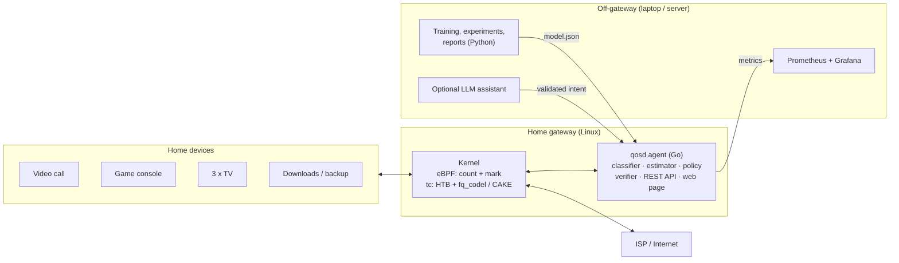

# Adaptive QoS Engine for Mixed Home Broadband Traffic (`qosd`)

> **Tata Elxsi Teliport Season 4, Case Study 3**
> An intent-aware, privacy-safe Quality-of-Service controller for a Linux home gateway.


-informational)


---

## Table of contents

- [The problem](#the-problem)
- [What qosd does](#what-qosd-does)
- [Architecture](#architecture)
- [Traffic classes](#traffic-classes)
- [Tech stack](#tech-stack)
- [Targets](#targets)
- [Documentation](#documentation)
- [Try the estimator model](#try-the-estimator-model)
- [Repository layout](#repository-layout)
- [Project status](#project-status)
- [License and third-party material](#license-and-third-party-material)

---

## The problem

A home connection is shared by video calls, games, TV streaming, downloads and backups. When a large download starts, the modem's buffer fills up, and every packet, including the call's packets, waits behind it. This **bufferbloat** can turn a 20 ms connection into a 300 ms one. Static priority rules can't tell what matters right now, and the link speed itself keeps changing.

## What qosd does

| Step | What happens | How |
|:---:|---|---|
| 1. **Observe** | Counts packet sizes and timing per connection, **headers only, never payload** | eBPF in the Linux kernel |
| 2. **Classify** | Sorts connections into 4 treatment classes, each decision with a confidence | LightGBM, compared against a rule baseline |
| 3. **Estimate** | Tracks the real link capacity and keeps the shaper just below it | Delay-based control using RTT probes, every 50 ms |
| 4. **Decide** | Applies guaranteed floors, caps and temporary user intents within hard limits | Deterministic policy engine |
| 5. **Enforce** | Queues and shapes traffic, IPv4 and IPv6 | Linux `tc`: HTB + fq_codel / CAKE |
| 6. **Verify** | Compares KPIs before and after each action; rolls back harm; safe mode on failure | Verifier + systemd watchdog |

**AI recommends, a deterministic engine decides, the kernel enforces.** An optional, off-gateway LLM assistant turns requests like *"prioritise my work call for 1 hour"* into validated intent JSON. It never touches the network configuration directly.

## Architecture



## Traffic classes

Classes describe **how traffic should be treated**, not which app it is.

| Class | Typical traffic | Floor | Ceiling | During a work-call intent |
|---|---|:---:|:---:|---|
| **RT** | Calls, voice, games | 20% | 40% | 40% / 60% |
| **STREAM** | Adaptive video | 30% | 100% | 20% / 100% |
| **DEFAULT** | Web, apps, unknown | 20% | 100% | 20% / 100% |
| **BULK** | Downloads, updates, backups | 10% | 100% | 10% / 50% |

Floors mean nothing starves; ceilings mean nothing takes over. Uncertain decisions fall back to DEFAULT, and users can correct any classification.

## Tech stack

| Layer | Technology | Why |
|---|---|---|
| Datapath | **eBPF (C)** via `cilium/ebpf` + `bpf2go` | Per-packet work at kernel speed; headers only |
| Enforcement | **Linux tc**: HTB, fq_codel, CAKE | Open and inspectable; provable floors and ceilings |
| Agent | **Go**, single static binary | Small footprint; cross-compiles to ARM routers |
| Classifier | **LightGBM** (trained in Python, evaluated in Go) | Accurate on tabular features, microsecond inference, explainable |
| Observability | **Prometheus + Grafana** | Live latency, jitter, loss, throughput, queue depth, fairness |
| Testbed | **Linux network namespaces** on Ubuntu 24.04 | Reproducible home / router / ISP / server emulation |
| Optional assistant | **Claude API** (hosted) or **Ollama** (local), off-gateway | Natural-language intents; validated before use |

The reasoning behind each choice is in [`docs/05_Improvements_and_Tech_Stack.md`](docs/05_Improvements_and_Tech_Stack.md) and [`docs/06_How_It_Works.md`](docs/06_How_It_Works.md).

## Targets

These are **targets** to be measured and reported honestly, met or not. Each is compared with no QoS and with static CAKE, across 11 scripted scenarios, at least 5 runs each, with 95% confidence intervals.

| Metric | Target |
|---|---|
| Classification accuracy (held-out testbed flows, ≥ 90% coverage) | **≥ 98%** |
| Shaper reaction when the link drops 100 → 20 Mbit/s | **≤ 0.5 s** |
| Added call latency at p99 during a large download | **≤ 30 ms** |
| Share of the link always kept for bulk traffic | **≥ 10%** |
| Agent CPU at 100 Mbit/s | **≤ 2% of one core** |

## Documentation

| Document | Read it for |
|---|---|
| [**How it works**](docs/06_How_It_Works.md) | **Start here.** Plain-language guide: what runs where, how classification works, why LightGBM, which LLM and what hardware it needs |
| [Software Requirements (SRS)](docs/01_SRS.md) | What the system must do: requirements with IDs, targets, scenarios, traceability |
| [System Design](docs/02_System_Design.md) | How it works in detail: packet path, modules, data structures, `tc` commands, algorithms, configuration (§12 is the source of truth for parameters) |
| [Build Plan](docs/03_Build_Plan.md) | Phases P0–P9 with tasks, exit criteria, timeline, MVP cut line and risks |
| [Design Review v1.0 → v1.1](docs/04_Design_Review.md) | Linux-networking review of the first design: defects found, fixes and evidence |
| [Improvements and Tech Stack](docs/05_Improvements_and_Tech_Stack.md) | Latency budget, where qosd can and cannot beat static CAKE, roadmap, layer-by-layer stack reasoning |
| [Plumbing and Leak Audit](docs/07_Plumbing_and_Leak_Audit.md) | Every channel traced end to end; 29 leaks found and the v1.2 fixes |

## Try the estimator model

`docs/sim/estimator_fluid_model.py` is a small fluid-queue model that compares the v1.0 and v1.1 capacity-estimator logic. It needs only Python 3, with no extra packages:

```bash
python docs/sim/estimator_fluid_model.py
```

Indicative results from this model (the real testbed will decide):

| Scenario | v1.0 | v1.1 |
|---|---|---|
| Download drops 100 → 20 Mbit/s: modem queue back under 15 ms | never (300 ms standing queue) | 0.91 s |
| Upload drops 20 → 5 Mbit/s: modem queue back under 15 ms | never | 2.05 s |
| Capacity returns 40 → 100 Mbit/s: shaper back to ≥ 85 Mbit/s | not applicable (v1.0 never cut) | 1.8–9.7 s |

## Repository layout

```text
.
├── README.md                      you are here
└── docs/
    ├── README.md                  documentation index
    ├── 01_SRS.md                  requirements
    ├── 02_System_Design.md        detailed design
    ├── 03_Build_Plan.md           phased implementation plan
    ├── 04_Design_Review.md        v1.0 → v1.1 review
    ├── 05_Improvements_and_Tech_Stack.md
    ├── 06_How_It_Works.md         plain-language guide
    ├── 07_Plumbing_and_Leak_Audit.md
    └── sim/
        └── estimator_fluid_model.py
```

The planned code layout (`bpf/`, `cmd/qosd/`, `internal/`, `ml/`, `testbed/`, `experiments/`, …) is described in [design §18](docs/02_System_Design.md#18-repository-layout).

## Project status

- [x] Requirements, system design and build plan (v1.2)
- [x] Design review with an estimator simulation
- [x] Plumbing and leak audit
- [ ] P0: environment and kernel spikes
- [ ] P1: testbed, traffic generators and baselines
- [ ] P2–P7: datapath, estimator, classifier, policy, dashboard, full evaluation
- [ ] P8–P9: optional extensions, documentation and submission

## License and third-party material

- No license file has been added yet, so all rights are reserved by the authors until one is chosen.
- The case-study brief and the submission template belong to Tata Elxsi and are **not** included in this repository.
- Third-party tools named in the docs (Linux, iproute2, cilium/ebpf, LightGBM, Prometheus, Grafana, and others) keep their own licenses. These will be confirmed and listed in `THIRD_PARTY.md` during Phase 0.
