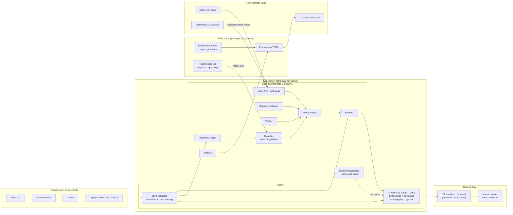
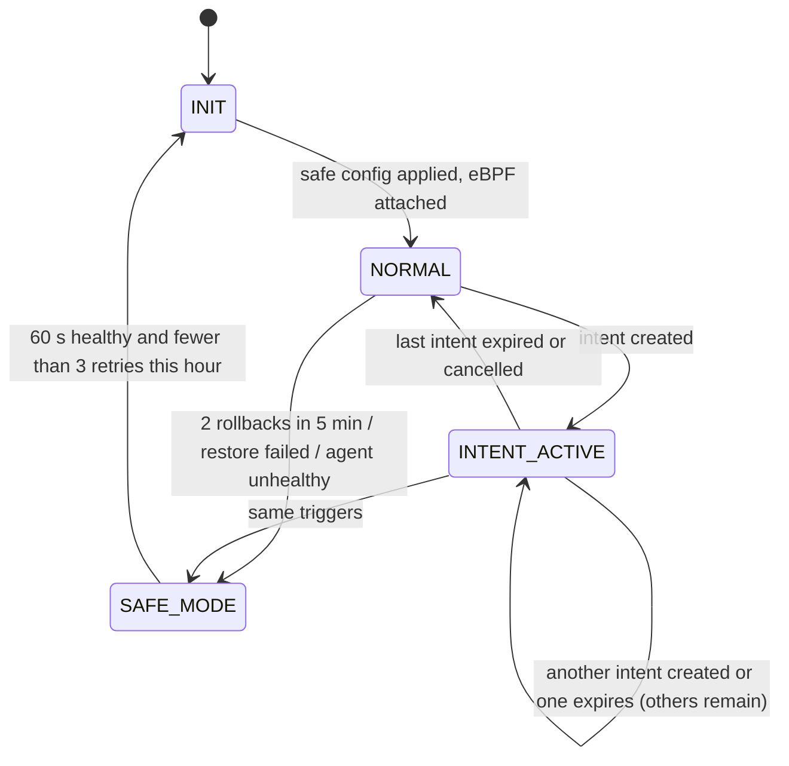
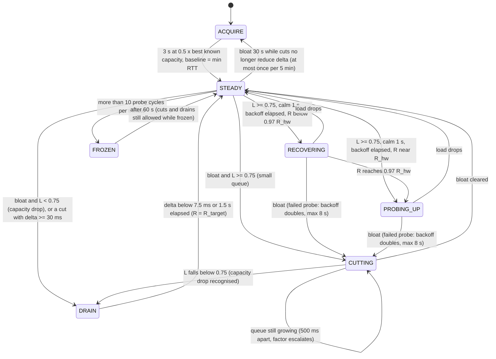

# System Design Document

**Project:** Adaptive QoS Engine for Mixed Home Broadband Traffic (`qosd`)
**Document version:** 1.2 (2026-10-30: applies `07_Plumbing_and_Leak_Audit.md`; L-xx tags point to the leak behind each change. v1.1 2026-10-29 applied `04_Design_Review.md`; R-xx tags)
**Date:** 2026-10-28
**Related:** `01_SRS.md` (requirements), `03_Build_Plan.md` (phased plan), `04_Design_Review.md` (v1.0 → v1.1 review), `07_Plumbing_and_Leak_Audit.md` (v1.1 → v1.2 audit)

> **How to read this:** sections 1–4 give the big picture. Section 5 specifies every module with its inputs, outputs, state, failure handling, success condition and test approach (the problem statement asks for exactly that). Sections 6–12 hold the exact data structures, commands, algorithms and APIs. Sections 13–22 cover operations, testing, the production boundary, and the items that must be verified in Phase 0 before we rely on them.

---

## 1. Purpose and scope
This document describes **how** `qosd` meets the requirements in the SRS. Every numeric parameter here matches the SRS; section 12 is the single source of truth for defaults.

## 2. Design principles
1. **No per-packet work in user space.** Per-packet work happens only in the kernel (eBPF + tc). User space wakes on fixed ticks (50 ms estimator, 1 s classifier) or on per-flow events (never per packet) and reads summaries.
2. **The gateway runs one small agent.** Dashboard, training, experiments and the optional LLM run off the gateway.
3. **AI recommends, a deterministic engine decides, the kernel enforces.** Every layer has hard bounds and a safe fallback.
4. **Classify by treatment, not by application.** Four classes are enough to queue traffic correctly, and fewer classes mean fewer confusions.
5. **Misclassification must be cheap.** Abstain to DEFAULT when unsure, cap RT, guarantee BULK a floor.
6. **Everything is inspectable.** Every decision has a reason code; every tc change has an equivalent `tc` command in the audit log.

## 3. Architecture overview

### 3.1 Component diagram



### 3.2 Layer mapping (required by the problem statement)

| Layer | Components | Runs on |
|---|---|---|
| Device | Household clients (in the testbed: one network namespace per client) | Client devices |
| Edge | eBPF datapath, tc hierarchy, `qosd` agent, systemd supervisor | Gateway |
| Network | ISP bottleneck and internet servers (testbed: `isp` and `srv` namespaces) | ISP / internet |
| Data | Prometheus time series, decision logs, run artefacts, datasets | Laptop / server |
| Analytics | Experiment runner, statistics, report generator, ML training | Laptop / server |
| User interface | Grafana dashboard, intent web page, optional LLM assistant | Browser |

### 3.3 Control loops and timing

| Loop | Period | Reads | Writes |
|---|---|---|---|
| eBPF datapath | per packet | packet headers, `class_map` | `flow_stats`, `skb->mark`, `skb->priority`, `events` ring buffer (one event per flow at packet 20) |
| RTT probing | 10 Hz per reflector (3 reflectors = 30 probes/s, a sample every ≈ 33 ms) | ICMP echo replies | RTT samples |
| Estimator | 50 ms tick; throughput over a sliding 250 ms window | RTT samples; download arrival bytes (eBPF `dir_bytes`), upload root-class bytes (tc stats over one persistent netlink socket) | shaper rate R (per direction) |
| Classifier | 1 s, plus immediately on each "20th packet" event | `flow_stats` (batch read) | class decisions → class resolver |
| Class resolver + reconciliation | 1 s (L-02) | decisions, overrides, intent pins, guardrails; `class_map` (batch read) | missing or different `class_map` entries, via the enforcer |
| Rate fast path | on every estimator change (L-01) | R per direction, current profile | class rates → enforcer queue (decreases immediately, increases ≤ every 250 ms and only if ≥ 1%) |
| Flow reaper | 1 s (with the classifier) | `flow_stats` last-seen times and FIN/RST flags | deletes idle flows from both maps |
| Neighbour and address tables | event-driven (netlink neighbour + address groups); full resync on `ENOBUFS` and every 60 s (L-14) | netlink events and dumps | `DeviceMap`, `gw_addrs` |
| Policy engine | 1 s tick + events (intent, verifier, health) | intents, verdicts, health | profile and FSM state (rates take the fast path above) |
| Enforcer | continuous; the **only** writer of tc and `class_map` (L-01) | command queue | netlink / `tc -batch` |
| Watchdog | every 2 s, only if all loops reported progress (L-07) | heartbeats | `sd_notify(WATCHDOG=1)` |
| State file | every 1 s (L-28) | R, C_est, baselines, policy state | `/run/qosd/state.json` (write + rename) |
| Verifier | continuous; 10 s windows around each action | KPIs | verdicts, rollback requests |
| Metrics scrape | Prometheus, 1 s | `/metrics` | TSDB |

---

## 4. Packet path

### 4.1 Download (internet → client)
1. A packet arrives on `wan0` and is NAT-reversed and routed to `lan0`.
2. At **`lan0` tcx egress**, the eBPF program `lan_egress`:
   - if the frame is not IP (e.g. ARP): sets the RT priority (fast lane, FR-ENF-10) and returns,
   - if the source is the gateway's own address: sets the direct-path priority `0x00010000` and returns (R-16; not WAN traffic),
   - if the packet is a fragment (more-fragments set or offset ≠ 0): counts it and leaves `skb->priority` unchanged, so the whole datagram uses DEFAULT (L-19),
   - builds the canonical flow key (client = destination address),
   - updates the DOWN counters in `flow_stats`, and adds `skb->len` to the per-CPU `dir_bytes` counter. That counter is the estimator's download T_obs: what the modem delivered, measured before our shaper (§8.2),
   - looks up `class_map[key]`. **Only if it finds a valid code 1–4** does it set `skb->priority = 0x00010000 | (class_code << 4)`, which selects HTB class `1:10`, `1:20`, `1:30` or `1:40`. On a miss it checks `device_pin[client]` (intent with scope `all`, L-21), then the fast lane (DNS/ICMP → RT), and otherwise leaves `skb->priority` unchanged.
3. The `lan0` root HTB qdisc picks the leaf class directly from `skb->priority` when it matches an existing leaf classid of that qdisc. Otherwise it uses `default 30` (DEFAULT).
4. The leaf qdisc (fq_codel or CAKE) applies per-flow or per-host fairness and AQM.

> **Pitfall avoided (R-02, FR-ENF-7):** HTB treats `skb->priority == qdisc handle` (`0x00010000` = `1:0`) as the **direct path**: the packet goes to an unshaped FIFO. A naive `0x00010000 | (0 << 4)` for an unclassified packet would therefore bypass the shaper. The datapath never writes that value for client traffic. Forwarded packets keep the small values set by `rt_tos2priority()`, which match no class, so HTB sends them to `default 30`.

### 4.2 Upload (client → internet)
1. A packet arrives on `lan0`.
2. At **`lan0` tcx ingress**, the eBPF program `lan_ingress`:
   - builds the canonical key (client = source address),
   - updates the UP counters,
   - looks up the class (or `device_pin`, or the fast-lane rule; fragments excluded) and writes it into the low byte of `skb->mark`, keeping the other mark bits,
   - **pure-ACK promotion (R-06, FR-ENF-9):** if the class is BULK and the packet is a TCP segment with only the ACK flag set and no payload (IP total length − IP header length − TCP data offset = 0; header fields only), it writes DEFAULT instead.
3. The packet is routed and masqueraded (IPv4) to `wan0`.
4. At **`wan0` tcx egress**, the eBPF program `wan_egress`:
   - if `skb->priority` is already `0x00010000` (estimator probes): leaves it, so probes stay on the direct path (§4.4),
   - reads `c = skb->mark & 0xff`. If `c` is 1–4 it sets `skb->priority = 0x00010000 | (c << 4)`,
   - if `c` is 0 (router-originated or unclassified): non-IP frames (ARP, PPPoE control), ICMP/ICMPv6 and DNS go to RT (fast lane, L-18); everything else keeps its priority and lands in DEFAULT.
   The HTB on `wan0` then selects the class.

**Mark conflicts (L-15):** another netfilter rule that writes `skb->mark` without a mask (e.g. `meta mark set ct mark`) after our ingress hook would erase the class. At start the agent scans the nftables/iptables rules for mark writes overlapping `mark_mask` and raises `MARK_CONFLICT`; `mark_mask` is configurable. **Spike SP-14** reproduces the conflict.

**Why `skb->mark` for upload instead of setting `skb->priority` at ingress:** the IPv4 forwarding path rewrites `skb->priority` from the packet's TOS byte (`ip_forward()` sets `skb->priority = rt_tos2priority(iph->tos)`). A priority set at LAN ingress would therefore be lost. `skb->mark` survives forwarding and NAT inside the same network namespace. **Phase 0 spike SP-3 verifies this on our exact kernel.**

### 4.3 Why shape download on LAN egress (no IFB)
Linux can only queue packets on egress. The usual way to shape download traffic is to redirect WAN ingress to an IFB device. Since every download packet leaves through `lan0` anyway, shaping on `lan0` egress achieves the same with one fewer device. It also sees internal addresses, so per-device fairness needs no NAT lookup. **Limit:** this assumes one LAN-facing interface (assumption A-1). With several LAN ports, shape on the bridge device or use IFB (see §21).

### 4.4 Router-originated traffic
- RTT probes are sent by the agent with `SO_PRIORITY = 0x00010000` (needs CAP_NET_ADMIN, which the agent has) and mark byte 0. On `wan0`, HTB sends them through the **direct path**, so they skip our own queues entirely (R-08, FR-EST-9). This costs about 30 × 84 B/s ≈ 20 kbit/s unshaped. In v1.0 they went through the RT class, so a backlog in RT inflated ΔD and made the estimator cut R for a queue the gateway itself had created.
- Probe replies come in on `wan0` and are delivered locally, so they never pass the download shaper on `lan0`. The probe RTT therefore measures the queue **beyond** the gateway (ISP/modem), which is exactly the signal the estimator needs. **Spike SP-8** verifies the direct-path behaviour.
- Traffic the gateway sends to the LAN (DNS answers from a local resolver, the agent's web page) also uses the direct path (§4.1). It does not cross the WAN, so it should neither use shaper budget nor count in T_obs.

### 4.5 Link-layer overhead (R-05, FR-ENF-8)
HTB and CAKE count `skb->len`. Real access links add framing per packet (e.g. CAKE's `docsis` keyword means overhead 18 B, mpu 64 B). Without compensation, small packets (VoIP, games, ACKs) are under-counted, so the shaper sends faster than the link really carries and the queue forms in the modem again. Both roots therefore carry a size table, `stab overhead <N> mpu <M> linklayer ethernet`, from `link.overhead_bytes` / `link.mpu_bytes`. The shaping CAKE configs (B1, SAFE_MODE) get the same values. CAKE leaves run `unlimited`, so the root `stab` covers them. **Testbed:** 0 / 0, because the emulated `tbf` counts the same bytes as our HTB. A real deployment sets the values for its access technology.

---

## 5. Module specifications

Every module follows the same template. "Test" means the test can run without root unless stated.

### 5.1 eBPF datapath (`bpf/flow.bpf.c`)
| Item | Specification |
|---|---|
| Responsibility | Per-packet flow accounting and class marking |
| Hooks | `lan_ingress` (tcx ingress `lan0`), `lan_egress` (tcx egress `lan0`), `wan_egress` (tcx egress `wan0`) |
| Inputs | Ethernet (+ one 802.1Q tag), IPv4/IPv6 (+ up to 4 extension headers) and TCP/UDP headers; `class_map`; `gw_addrs` |
| Outputs | `flow_stats` updates; `skb->mark` low byte (upload); `skb->priority` (both directions, only for a valid class, the fast lane or gateway-to-LAN traffic); `events` ring buffer |
| State | `flow_stats` (LRU hash, 16,384 entries), `class_map` (LRU hash, 16,384 entries), `device_pin` (hash, 64 entries: client IP → class, L-21), `gw_addrs` (array: the gateway's own LAN addresses, rewritten by the agent on every address change), `dir_bytes` (per-CPU array), `events` (ring buffer, 64 KB), `counters` (per-CPU array: parsed, unparsed, ipv6, fragments) |
| Parsing rules (R-10, FR-TEL-3) | Honour IHL; for non-first fragments, count the packet against a port-less key and never read the bytes where ports would be (they are payload); walk extension headers with a bounded loop; direct packet access with bounds checks, and `bpf_skb_pull_data` only if the headers are not in the linear area |
| GSO (R-20, FR-TEL-9) | `pkts += max(1, skb->gso_segs)`; size bin from `skb->len / max(1, gso_segs)`. Correct with GRO/TSO on; the testbed still disables offloads for clean measurements |
| Events (R-14, FR-CLS-12) | A `total_pkts` counter is incremented by `n = max(1, gso_segs)` with an atomic fetch-and-add; the CPU whose old value satisfies `old < 20 && old + n >= 20` emits one `{flow_key}` event (L-08: with GSO the counter can jump past 19). One event per flow, never per packet |
| Sizes (L-22) | Size bins and features use the L3 length (IPv4 total length, IPv6 payload length + 40; for GSO, `gso_size` + header lengths), not `skb->len` |
| Return code (L-16) | `TCX_NEXT`, so programs attached after ours still run (**spike SP-15**) |
| Build | Only UAPI `__sk_buff` and packet headers are used, so no `vmlinux.h`/CO-RE is needed (R-22) |
| Failure handling | Any parse failure → increment `unparsed`, leave the packet unmarked (it goes to DEFAULT). Ring buffer full → event dropped (the 1 s cycle still classifies the flow). The program never drops packets |
| Success condition | Counters match generator ground truth within ±1% in a controlled test; no forwarding errors; cost per packet measured (NFR-PERF-6) |
| Test | `BPF_PROG_TEST_RUN` with crafted packets: IPv4/IPv6 TCP/UDP, IPv4 options, VLAN, IPv4 and IPv6 fragments (assert no port read), extension-header chains, pure ACKs, GSO packets, unclassified packets (assert priority unchanged). Needs root; runs in the VM or a hosted CI runner |

### 5.2 Telemetry reader (`internal/telemetry`)
| Item | Specification |
|---|---|
| Responsibility | Turn kernel counters into per-flow feature windows and link/class statistics |
| Inputs | `flow_stats` batch read every 1 s; tc class stats (bytes, packets, drops, backlog) every 1 s; neighbour events from netlink (MAC ↔ IP) |
| Outputs | `FlowWindow` records (features in §6.3); `ClassStats`; `DeviceMap`; deletions of reaped flows |
| State | Ring buffer of the last 10 windows per flow; previous counter snapshot (for deltas) |
| Reaping (R-19, FR-TEL-8) | Flows idle for 30 s, or for 5 s after a FIN/RST flag was seen, are batch-deleted from `flow_stats` and `class_map`. Keeps the map small, so the 1 s read stays fast and LRU eviction rarely runs |
| User-space state GC (L-20) | All per-flow user-space state (windows, smoothing, streaks, guardrail timers) is dropped when a flow is reaped or absent from 3 consecutive batch reads (e.g. evicted by the kernel LRU) |
| Netlink events (L-14) | Neighbour and address groups; on `ENOBUFS` (lost events) a full dump resynchronises `DeviceMap` and `gw_addrs`; a full resync also runs every 60 s |
| Failure handling | Map read error → skip this cycle, increment `qos_telemetry_errors_total`; 3 consecutive failures → report unhealthy to the verifier |
| Success condition | Deltas computed correctly across counter resets and LRU evictions (a flow that disappears and reappears restarts its windows) |
| Test | Feed recorded map snapshots; assert feature values against hand-computed expectations |

### 5.3 Classifier (`internal/classifier`)
| Item | Specification |
|---|---|
| Responsibility | Assign one treatment class per flow, with confidence and source |
| Inputs | `FlowWindow` stream; "20th packet" events (provisional classification from a partial window covering the flow's age so far; record mode emits such rows too, so the model is trained on them); overrides (from API); model file |
| Outputs | `ClassDecision{flow, class, confidence, source, probs[4]}` to the class resolver (§5.5), which alone decides what reaches `class_map` (L-02) |
| State | Per flow: smoothed probability vector, consecutive-window counter for the hysteresis rule, current class, guardrail timers |
| Pipeline | Stage 0 override → Stage 1/2 model (rules or ML) → Stage 3 smoothing + hysteresis → Stage 4 guardrails → abstain (algorithm in §8.1) |
| Model reload (L-27) | `SIGHUP` loads the new `model.json`: schema and SHA-256 checked, atomic swap, the old model kept on failure; judged by the verifier as a `MODEL_RELOAD` action |
| Corrections log (L-27) | Each user correction appends `{ts, features of the last window, predicted, corrected}` to `/var/lib/qosd/corrections.jsonl` (at most 10,000 lines, oldest dropped) |
| Failure handling | Model missing, invalid or schema-mismatched → rule classifier + alert `CLASSIFIER_FALLBACK`. Inference error for one flow → DEFAULT for that flow |
| Success condition | NFR-ACC-1/2 on held-out scenarios; no class flapping beyond NFR-STAB-3 |
| Test | Replay recorded feature windows with known labels; property tests for the hysteresis rule (never switches on one noisy window) |

### 5.4 Capacity estimator (`internal/estimator`)
| Item | Specification |
|---|---|
| Responsibility | Keep the shaper rate just below the real bottleneck, per direction |
| Inputs | RTT samples from 3 reflectors (direct path); T_obs every 50 ms, measured on the bottleneck side: download = arrival bytes at `lan0` before the shaper (eBPF per-CPU `dir_bytes`), upload = `wan0` root-class (`1:1`) bytes sent (tc stats, one persistent netlink socket) |
| Outputs | Shaper rate R_down, R_up; capacity estimates C_est and high-water R_hw; events `CAPACITY_DROP`, `DRAIN`, `RECOVER_UP`, `LINK_DEGRADED`, `EXTERNAL_BLOAT` |
| State | Per reflector: smoothed RTT and baseline RTT. Per direction: R, R_target, R_base, R_hw, C_est (EWMA), last cut time, ΔD at last cut, cuts in the current bloat episode, probe backoff and hold-until time, probe-cycle counter, state ACQUIRE / STEADY / CUTTING / DRAIN / RECOVERING / PROBING_UP / FROZEN; outstanding-probe table (entries expire after 1 s and count as loss, L-20) |
| Algorithm | §8.2 |
| Baseline acquisition (L-05, FR-EST-11) | At every start, R = 0.5 × best known capacity (C_est from `state.json`, else nominal) for 3 s; baseline = minimum RTT in that time. Re-acquire with a 2 s dip if bloat persists 30 s while cuts no longer reduce ΔD (at most once per 5 min). Without this, a start under load learns the bloated RTT as "normal" |
| Failure handling | Fewer than 2 reflectors responding → hold R, alert `REFLECTORS_DOWN`. Bloat with T_obs < 0.5 Mbit/s → hold, alert `EXTERNAL_BLOAT` (not our queue). R at R_min with ΔD still high for 10 s → `LINK_DEGRADED`, stop cutting |
| Success condition | NFR-UX-2, NFR-UX-6, NFR-ACC-4, NFR-STAB-2 |
| Test | Simulation harness: a fluid queue model driven by synthetic capacity traces. It **must model where T_obs is measured**: download T_obs = min(offered, true capacity) (measured after the bottleneck); upload T_obs = min(offered, R) (measured before it). v1.0's load-gate defect (R-01) only shows up with this model. Assert reaction time, drain time, recovery time and convergence for S2, S5 and S11 traces |

### 5.5 Policy engine (`internal/policy`)
| Item | Specification |
|---|---|
| Responsibility | Turn classes, rates, intents and verdicts into one desired configuration, within hard bounds |
| Inputs | Class decisions, R per direction, active intents, verifier verdicts, health signals |
| Outputs | `DesiredConfig{profile, rates per class per direction, class_map updates}`; decision-log entries |
| Rate fast path (L-01) | `Scale(R, profile)` is a pure function (profile percentages × R, RT ceiling minimum, validation) called on every estimator change; its result goes straight to the enforcer queue without waiting for the 1 s tick |
| Class resolver (L-02, FR-POL-7) | Final class per flow = user override > guardrails (G1, G2) > intent pin > model / rules > none. User overrides are exempt from guardrails but bounded by the RT ceiling. Output is the complete desired `class_map` for live flows, reconciled by the enforcer every second |
| Intent leases (L-06) | Deadlines on the monotonic clock; persisted to `/var/lib/qosd/intents.json` (wall-clock expiry); restored on start only if the clock is synchronised and the lease has not expired, otherwise `INTENT_LOST` is logged and shown. Device membership is re-resolved on every neighbour change; `scope=all` also fills `device_pin` |
| Internal SAFE_MODE (L-25) | Enforcer installs the static CAKE config of §5.9; estimator rate changes and the policy stop; telemetry and eBPF keep running (CAKE ignores our priority values, whose minor number exceeds its tin count, **spike SP-16**) |
| State | FSM: INIT, NORMAL, INTENT_ACTIVE, SAFE_MODE (§9.1); last profile-switch time; intent leases |
| Rules | Profiles from §12; floors and ceilings enforced by validation (BULK floor ≥ 10%, RT ceiling ≤ 60% but never below min(R, 4 Mbit/s) (L-03), sum of floors ≤ 100%); intent-driven profile switches applied within 1 s, with intent events inside 1 s coalesced (L-13); SAFE_MODE immediate |
| Failure handling | Invalid desired config (fails validation) → reject, log `POLICY_INVALID`, keep the current config |
| Success condition | Every applied config passes validation; every change has a reason code |
| Test | Table-driven tests: (state, event) → (new state, config); fuzz test that random inputs never produce a config violating the bounds |

### 5.6 Enforcer (`internal/enforcer`)
| Item | Specification |
|---|---|
| Responsibility | The **single writer** of tc and the kernel class table (L-01): applies configurations, rate changes and class entries |
| Inputs | `DesiredConfig` |
| Outputs | tc changes through netlink; `class_map` writes; audit log of equivalent `tc` commands |
| State | Command queue (one goroutine; per direction only the latest rate command is kept); last applied state |
| Coalescing (L-01) | Rate decreases applied immediately; increases at most every 250 ms and only if ≥ 1% different. Worst case ≈ 20 updates/s during cuts, typically ≤ 4/s |
| Reconciliation (L-02) | Every 1 s: batch-read `class_map` for live flows, compare with the resolver's desired entries, rewrite missing or different ones. Heals LRU evictions, lost writes and restarts |
| Operations | **Init:** render the HTB trees and leaves (§7) into one `tc -batch` file and apply it with a single exec. That file is also the audit record, and `tc` handles `stab` and CAKE options that netlink libraries may not (R-23). **Runtime:** HTB `class change` over netlink for rates (no queue flush), always sending `rate`, `ceil`, `quantum`, `burst` and `cburst` explicitly (R-17, FR-ENF-11). If `quantum` is left out the kernel recomputes it from `r2q`; `tc` and netlink libraries also compute default bursts differently. When R crosses the low-rate threshold, `tc qdisc change` updates the fq_codel target and interval (no flush). Order: when decreasing, children first, then the parent; when increasing, the parent first. HTB itself does not reject children whose rates sum above the parent's, so this ordering and the policy validation are our only guard |
| Failure handling | Any netlink error → **re-render** the desired state from current inputs (current R, profile, classes) and re-apply; an old snapshot is never replayed, because it would fight the estimator (L-12). Re-apply failure → request SAFE_MODE |
| Success condition | Kernel state read back after apply equals desired state |
| Test | Integration test in a namespace (root): apply, read back with `tc -j`, compare; inject failures (invalid classid) and confirm restore |

### 5.7 Intent API (`internal/api`)
| Item | Specification |
|---|---|
| Responsibility | Let users and the optional assistant create intents and correct classes |
| Inputs | HTTP requests (§11) |
| Outputs | Intent leases to the policy engine; overrides to the classifier; state and decision queries |
| State | Active leases (max 3, persisted, see §5.5); override rules (`/var/lib/qosd/overrides.json`): `{id, match: {device_mac, proto?, remote_port?, remote_prefix?}, class, expires_at}`, at most 256, default expiry 30 days (L-10); browser sessions |
| Authentication (L-09) | API clients (assistant, scripts) use the bearer token. The web page never contains the token: the user signs in once and gets an `HttpOnly`, `SameSite=Strict` session cookie plus a CSRF token. Every request's `Host` header must match the gateway address (DNS-rebinding defence) |
| Failure handling | Schema-invalid input → `400` with field errors. Over the limit → `409`. Auth missing or invalid → `401`. Rate limit → `429` |
| Success condition | Every accepted intent is reflected in the policy state within 1 s; every lease expires on time (±1 s) |
| Test | HTTP handler tests with a fake policy engine |

### 5.8 Verifier (`internal/verifier`)
| Item | Specification |
|---|---|
| Responsibility | Judge whether each action helped, and trigger rollback or SAFE_MODE on harm |
| Inputs | KPIs: RT-probe RTT (p50/p95), probe jitter (RFC 3550), probe loss, per-class throughput, backlog and queue-delay estimate (backlog × 8 ÷ class rate), estimator state and probe-cycle count |
| Outputs | Verdicts IMPROVED / NEUTRAL / REGRESSED / UNKNOWN per action; rollback requests (the inverse of the specific action, L-12); SAFE_MODE requests. (The v1.1 "freeze requests" output is removed: the estimator owns its oscillation freeze, L-23) |
| Rules | FR-VER-1..5 (thresholds in §12). An action's post-window ends at the next policy action; shorter than 5 s → UNKNOWN (L-23) |
| Attribution (R-25) | Only policy actions are judged (profile switch, intent start/end, override, config reload, classifier mode change). Estimator rate changes are never rolled back. A latency regression is not blamed on a policy action while the estimator is in CUTTING or DRAIN, because a capacity event explains it. Starvation right after a policy action → roll back that action (§8.3). Starvation with no policy action in the last 10 s means the HTB floors themselves failed (a bug) → SAFE_MODE request directly |
| Failure handling | Missing KPIs (e.g. reflectors down) → verdict UNKNOWN, no rollback on missing data alone, alert |
| Success condition | S6, S7, S8 behave as specified; no rollback storms (2 rollbacks in 5 minutes means SAFE_MODE, not a third rollback) |
| Test | Replay KPI traces with injected regressions and starvation |

### 5.9 Safety supervisor (`deploy/`)
| Item | Specification |
|---|---|
| Responsibility | Guarantee a known safe state when the agent is not running correctly |
| Mechanism | systemd unit with `WatchdogSec=5`, `Restart=on-failure`, `RestartSec=60`, `StartLimitIntervalSec=3600`, `StartLimitBurst=3` (systemd's restart limit then matches FR-SAF-4), `ExecStopPost=/usr/local/sbin/qos-safe-mode`, `ReadWritePaths=/var/lib/qosd /run/qosd` (needed because `ProtectSystem=strict` makes everything else read-only). The agent notifies the watchdog every 2 s **only if** the estimator (500 ms), enforcer (2 s), classifier (3 s) and policy (3 s) loops all reported progress within those deadlines (L-07). eBPF links are not pinned, so they detach when the process exits |
| Safe config | `tc qdisc replace … root cake bandwidth <0.8 × last R> besteffort dual-dsthost ingress` on `lan0`, and `… besteffort dual-srchost nat ack-filter` on `wan0`, both with the configured `overhead`/`mpu`. Last R is read from `/run/qosd/state.json`, which the agent rewrites every 1 s (temp file + rename, L-28), else from the configured fallback |
| Failure handling | If the script itself fails, it logs to the journal and leaves the HTB default class in place (still shaped and fair) |
| Success condition | NFR-REL-1 in S8 |
| Test | S8: `kill -9` the agent mid-run; measure time until the CAKE config is present and RT latency stays bounded |

### 5.10 Metrics and dashboard
| Item | Specification |
|---|---|
| Responsibility | Make behaviour visible live and after the fact |
| Outputs | Prometheus metrics (§13.1); Grafana dashboard JSON in `dashboards/` |
| Panels | Latency (probe and application), jitter, loss, throughput per class and direction, queue depth per class, Jain's fairness, shaper rate vs capacity estimate vs true rate (testbed), classifier confidence, policy state timeline, decision annotations |
| Placement | Prometheus and Grafana run off the gateway |

### 5.11 Experiment runner (`experiments/`)
| Item | Specification |
|---|---|
| Responsibility | One-command, reproducible baseline-vs-optimised evidence |
| Inputs | Scenario YAML (traffic, impairment timeline, duration, seed); configuration (B0, B1, B2-rules, B2-ML); repeat count |
| Outputs | Per-run folder: generator logs, tc snapshots, Prometheus export, metadata (versions, seeds, git commit); aggregated HTML/Markdown report with charts and confidence intervals |
| Steps | reset testbed (stop agent, delete `/var/lib/qosd` and `/run/qosd`, recreate namespaces so kernel maps are fresh, L-17) → apply config → start generators → apply impairment timeline → collect → teardown → analyse. A hash of the starting state goes into the run metadata |
| Failure handling | Any step fails → mark run INVALID with reason; never silently drop runs from the report |
| Success condition | Re-running a scenario gives the same conclusions within the reported confidence intervals |

### 5.12 ML pipeline (`ml/`, offline)
| Item | Specification |
|---|---|
| Responsibility | Build the dataset, train, evaluate and export the classifier |
| Inputs | Feature recordings (agent in record mode) labelled by generator ground truth; optional consented real captures converted with an offline extractor that mirrors the eBPF logic |
| Outputs | `model.json` (LightGBM `dump_model()`), `model.meta.json` (schema version, feature list, thresholds, SHA-256, training data hash), evaluation report |
| Key rules | Split by run/scenario, never by window. Choose thresholds on the validation set only. Report calibration (reliability diagram, expected calibration error) |
| Label-leakage controls (L-04, NFR-ACC-5) | Random generator mixes per client namespace in every run; DSCP marking randomised per run; no identifiers as features; S10 uses a call profile held out from training; **leakage check**: a model on only port bucket, DSCP and flows-per-device must score clearly below the full model, otherwise the dataset is fixed before any accuracy is reported |
| Parity | A Go evaluator walks the dumped trees. A parity test asserts max absolute probability difference vs Python ≤ 1e-6 on the test set |

### 5.13 Optional LLM assistant (`assistant/`, off-gateway)
| Item | Specification |
|---|---|
| Responsibility | Natural-language intent creation and plain-language explanations |
| Tools exposed to the model | `create_intent` (calls the REST API), `get_state`, `get_decisions`, `list_flows` (all read-only except `create_intent`) |
| Guardrails | Model output is validated against the intent JSON schema before any call. The user must **confirm** the parsed intent before `create_intent` runs. Tool outputs are untrusted data: device names are limited to 32 printable characters and quoted (DHCP hostnames are attacker-controlled, L-09). The policy engine applies its own bounds regardless. The assistant has no shell, tc or config access |
| Deployment | Local model (e.g. through Ollama) for privacy, or a hosted API. In hosted mode, tool outputs replace remote IPs and MACs with pseudonymous labels (NFR-PRIV-2) |
| Evaluation | 100-utterance test set: parse accuracy and rejection rate vs a regex/keyword parser baseline |
| Failure handling | Model unavailable or output invalid → the web page and REST API keep working; the assistant says it couldn't parse the request |

---

## 6. Data structures

### 6.1 Class codes
| Class | Code | HTB classid | `skb->priority` value |
|---|---|---|---|
| RT | 1 | `1:10` | `0x00010010` |
| STREAM | 2 | `1:20` | `0x00010020` |
| DEFAULT | 3 | `1:30` | `0x00010030` |
| BULK | 4 | `1:40` | `0x00010040` |

`tc` writes the minor number in hexadecimal, so `1:10` means major 1, minor 0x10. The mapping is minor = code × 0x10.

### 6.2 eBPF maps
```c
struct flow_key {            // canonical: client side first
    __u8  client_ip[16];     // IPv4 stored as IPv4-mapped IPv6 (::ffff:a.b.c.d)
    __u8  remote_ip[16];
    __u16 client_port;
    __u16 remote_port;
    __u8  proto;             // IPPROTO_TCP / IPPROTO_UDP
    __u8  pad[3];
};

struct dir_stats {
    __u64 pkts, bytes;
    __u64 hist[8];           // size bins: <=64, <=128, <=256, <=512, <=1024, <=1280, <=1400, >1400 bytes
    __u64 iat_sum_us;        // inter-arrival time, ns >> 10 (~us), clamped to 1,000,000
    __u64 iat_sq_sum_us;     // sum of squares (fits u64 for > 10^7 clamped samples)
    __u64 last_ts_ns;
};

struct flow_val {
    struct dir_stats up, down;
    __u64 first_ts_ns;
    __u64 total_pkts;        // atomic fetch-and-add of n; emit one event when old < 20 && old + n >= 20
    __u8  dscp_first;        // DSCP of the first packet seen
    __u8  tcp_flags_seen;    // OR of FIN/RST bits, for fast reaping
    __u8  pad[6];
};
// flow_stats: BPF_MAP_TYPE_LRU_HASH, key=flow_key, value=flow_val, max_entries=16384
// class_map:  BPF_MAP_TYPE_LRU_HASH, key=flow_key, value=__u8 class_code, max_entries=16384
// device_pin: BPF_MAP_TYPE_HASH,     key=client_ip[16], value=__u8 class_code, max_entries=64 (intent scope=all)
// gw_addrs:   BPF_MAP_TYPE_ARRAY,    up to 8 gateway LAN addresses (16 B each)
// dir_bytes:  BPF_MAP_TYPE_PERCPU_ARRAY, [0] = download bytes arriving at lan0 egress (before the shaper,
//             excluding direct-path traffic); read every 50 ms as the estimator's download T_obs
// events:     BPF_MAP_TYPE_RINGBUF,  64 KB, records = struct flow_key
```
- Size: key 40 B + value 232 B, so about 4.5 MB of keys and values for `flow_stats` at full capacity, plus the kernel's per-entry overhead. That is close to the NFR-PERF-2 limit of 5 MB. Check the real total with `bpftool map show` (memlock). If it is over, reduce `max_entries` to 8,192, which is plenty with reaping. With reaping (FR-TEL-8) a home network normally uses a few hundred to a few thousand entries.
- The default (common) LRU is kept. `BPF_F_NO_COMMON_LRU` was considered and rejected: it splits capacity per CPU and can evict early when most new flows arrive on one CPU. Reaping solves LRU contention more safely (R-19).
- `class_map` stays a separate map. Merging the class into `flow_val` would save one lookup per packet, but userspace can only rewrite the whole value, which races with kernel counter updates. Revisit only if NFR-PERF-6 fails.
- Counters use atomic adds. Inter-arrival timestamps are best-effort under concurrent updates; packets of one flow are normally processed on one CPU, so the error is small. The design accepts this approximation.
- The testbed disables GRO/GSO/TSO on veth interfaces so packet sizes are real wire sizes (§16).

### 6.3 Feature vector (per flow, per 1 s cycle, computed in user space)
| Group | Features |
|---|---|
| Rate | bytes/s up, bytes/s down, packets/s up, packets/s down, up/down byte ratio |
| Size | mean size up/down, 8-bin size fractions up/down, small-packet fraction (≤ 128 B) |
| Timing | inter-arrival mean and coefficient of variation, up and down |
| Temporal (10-window ring) | active-seconds fraction, coefficient of variation of bytes per second, longest idle gap, total bytes so far |
| Flow | age, L4 protocol, remote-port bucket (443 / configured real-time ports / other), DSCP of first packet |
| Device context | number of active flows on the same client IP (kept only if the leakage check of §5.12 shows it is not a proxy for the testbed topology) |

Sizes are L3 lengths (§5.1, FR-TEL-10). The feature list and order are versioned (`schema_version`). The model metadata must match it (FR-CLS-10).

### 6.4 Decision log entry (JSON Lines)
```json
{"ts":"2026-10-28T14:02:11.250Z","reason":"CAPACITY_DROP","dir":"down",
 "inputs":{"load":0.97,"delta_rtt_ms":41.2,"t_obs_mbit":20.4},
 "action":{"shaper_mbit":{"from":90.0,"to":18.4}},"verdict":null,"policy_state":"NORMAL"}
```
Reason codes: `INIT`, `CAPACITY_DROP`, `DRAIN`, `RECOVER_UP`, `PROBE_UP`, `FREEZE`, `LINK_DEGRADED`, `EXTERNAL_BLOAT`, `CLASS_ASSIGN`, `CLASS_CHANGE`, `GUARDRAIL_G1`, `GUARDRAIL_G2`, `OVERRIDE`, `INTENT_START`, `INTENT_END`, `ROLLBACK`, `SAFE_MODE_ENTER`, `SAFE_MODE_EXIT`, `CLASSIFIER_FALLBACK`, `POLICY_INVALID`, `REFLECTORS_DOWN`, `ACQUIRE`, `INTENT_LOST`, `MARK_CONFLICT`, `MODEL_RELOAD`. Estimator decisions are logged only at state transitions and cuts; a RECOVERING phase is summarised in one entry when it ends (L-11).

---

## 7. tc hierarchy

### 7.1 Download (`lan0`), example at R = 90 Mbit/s, NORMAL profile
Generated by the enforcer and applied with `tc -batch` (one exec; the file is the audit record). `burst` = `cburst` = max(2 × 1514 B, R × 1 ms) = 11,250 B at 90 Mbit/s. The `stab` values come from `link.overhead_bytes` / `link.mpu_bytes` (0 / 0 in the testbed, §4.5).
```bash
qdisc replace dev lan0 root handle 1: stab overhead 0 mpu 0 linklayer ethernet htb default 30
class add dev lan0 parent 1:  classid 1:1  htb rate 90mbit ceil 90mbit quantum 1514 burst 11250 cburst 11250
class add dev lan0 parent 1:1 classid 1:10 htb rate 18mbit ceil 36mbit prio 0 quantum 1514 burst 11250 cburst 11250
class add dev lan0 parent 1:1 classid 1:20 htb rate 27mbit ceil 90mbit prio 1 quantum 1514 burst 11250 cburst 11250
class add dev lan0 parent 1:1 classid 1:30 htb rate 18mbit ceil 90mbit prio 2 quantum 1514 burst 11250 cburst 11250
class add dev lan0 parent 1:1 classid 1:40 htb rate 9mbit  ceil 90mbit prio 3 quantum 1514 burst 11250 cburst 11250
qdisc add dev lan0 parent 1:10 handle 10: fq_codel
qdisc add dev lan0 parent 1:20 handle 20: cake unlimited besteffort dual-dsthost
qdisc add dev lan0 parent 1:30 handle 30: fq_codel
qdisc add dev lan0 parent 1:40 handle 40: cake unlimited besteffort dual-dsthost
```

### 7.2 Upload (`wan0`), example at R = 18 Mbit/s
The same structure, with rates and bursts scaled to R_up (burst = max(3028 B, 2250 B) = 3,028 B). The STREAM leaf is `cake unlimited besteffort dual-srchost nat`. The BULK leaf is `cake unlimited besteffort dual-srchost nat ack-filter`. The `nat` keyword makes CAKE look up pre-NAT addresses in conntrack, so per-device fairness still works after masquerading. `ack-filter` drops ACKs that a later ACK in the same queue makes redundant (R-06).

### 7.2a Low-rate AQM adjustment (R-12, FR-ENF-11)
At low rates one full-size packet takes longer to send than CoDel's 5 ms target, and fq_codel then drops far too much. When R changes, the enforcer computes `target = max(5 ms, 1.5 × 1514 × 8 / R)` and `interval = 100 ms + (target − 5 ms)`, and applies them to the fq_codel leaves with `tc qdisc change` (no flush) only when the target changes by more than 1 ms. The adjustment starts below about 3.6 Mbit/s, so in practice it only applies to upload after deep cuts. CAKE `unlimited` leaves do not know the rate; spike SP-11 checks their behaviour at 1–4 Mbit/s and, if needed, raises their `rtt` parameter.

### 7.3 Why each piece
| Piece | Reason |
|---|---|
| HTB root class at R | The single shaper that moves the queue from the modem to us |
| HTB `rate` per class | Guaranteed floor: provable anti-starvation (BULK ≥ 10%) |
| HTB `ceil` per class | Cap: RT can never take over the link, even if misclassified traffic lands there. The RT ceiling is never below min(R, 4 Mbit/s) (L-03): an HTB `ceil` caps a class even when the link is idle, so 40% of a 4.5 Mbit/s uplink (1.8 Mbit/s) would throttle a lone video call |
| HTB `prio` | Lower number is served first among classes within their rate and when borrowing spare bandwidth |
| `quantum 1514` | MTU-sized quantum; avoids HTB's "quantum is big/small" warnings at these rates. Sent on **every** change, otherwise the kernel recomputes it from `r2q` |
| explicit `burst`/`cburst` | About 1 ms at R. Limits line-rate bursts into the modem's queue on upload, and makes the audit `tc` command really equivalent to what netlink applied |
| `stab … overhead/mpu` | Link-layer overhead compensation (§4.5) |
| fq_codel leaves (RT, DEFAULT) | Per-flow fairness and CoDel AQM inside each class (RFC 8290). New and sparse flows (e.g. a call that ended up in DEFAULT) are served first |
| CAKE leaf for STREAM | Per-device fairness: 3 TVs share STREAM fairly even if one opens more connections (NFR-UX-4) |
| CAKE leaf for BULK | Per-device fairness, so a client with 16 connections doesn't crowd out other devices' bulk traffic; `ack-filter` on upload |
| `default 30` | Unclassified traffic is still shaped, fair and AQM-managed |
| Direct path (`1:0`) | Only estimator probes and gateway-to-LAN traffic; never client traffic (FR-ENF-7) |

This mirrors the well-known `sqm-scripts` "simple.qos" approach (HTB + fq_codel) and adds eBPF classification, adaptive rates and intents.

### 7.4 Baseline configurations
- **B0:** `tc qdisc replace dev lan0 root pfifo limit 1000` and the same on `wan0` (a plain FIFO at the gateway). The modem emulator keeps its deep buffer.
- **B1:** `tc qdisc replace dev lan0 root cake bandwidth 90mbit besteffort dual-dsthost ingress` and `tc qdisc replace dev wan0 root cake bandwidth 18mbit besteffort dual-srchost nat ack-filter`, both with the configured `overhead`/`mpu`. Static: it never changes rate. `ingress` is used because download is shaped after the bottleneck: CAKE then counts dropped packets against the rate, since they already used bottleneck capacity. B1 is deliberately configured the way an expert would deploy static CAKE. Beating a weak baseline would prove nothing (R-09).

---

## 8. Algorithms

### 8.1 Classifier pipeline (per flow, every 1 s)
```text
if override exists for flow (or matching persisted rule):
    decide(class=override, conf=1.0, source="override"); return
if flow.total_pkts < 20 and flow.class is None:
    return                                   # not enough data yet (FR-CLS-3)

p = model.predict_proba(features)            # rules: one-hot with fixed confidence; ML: LightGBM softmax
flow.p_smooth = 0.5 * p + 0.5 * flow.p_smooth  (first time: p_smooth = p)
best = argmax(flow.p_smooth)

if flow.class is None:                       # first assignment
    if max(flow.p_smooth) >= 0.60: assign(best, source=model_name)
    else: assign(DEFAULT, source="default")  # abstain (FR-CLS-4)
elif best != flow.class:                     # hysteresis (FR-CLS-5)
    if flow.p_smooth[best] > 0.85:
        flow.streak = flow.streak + 1 if best == flow.candidate else 1
        flow.candidate = best
    else:
        flow.streak = 0
    if flow.streak >= 3:
        assign(best, source=model_name); flow.streak = 0
else:
    flow.streak = 0                          # current class still best: reset

# guardrails (FR-CLS-6/7), checked after the model:
if flow.class == RT and flow.rate_mbit > 8 for >= 5 s:                 assign(STREAM, "guardrail") # G1 (R-07)
if flow.class == DEFAULT and flow.total_bytes >= 20 MB
   and flow.longest_idle_gap_last_10s < 2 s:                           assign(BULK, "guardrail")  # G2
```
**Precedence (FR-POL-7, L-02):** these decisions feed the class resolver (§5.5), which applies user override > guardrails > intent pin > model / rules > none, and the enforcer reconciles the result into `class_map` every second.

**Intent pinning** (FR-INT-4) is applied by the class resolver after classification: for a device under an intent, `scope=realtime` pins flows with p_smooth[RT] ≥ 0.4 to RT, and `scope=all` pins all its flows. G1 still applies to pinned flows, so a sync job on the same laptop cannot ride in RT next to the call.

**Why G1 demotes to STREAM, not BULK:** cloud gaming and high-resolution screen sharing are latency-critical and often run well above 8 Mbit/s. STREAM takes them out from under the RT ceiling without dropping them to the lowest class.

**Event-driven provisional class (FR-CLS-12):** on a "20th packet" event the same pipeline runs at once for that flow, using a partial window that covers the flow's age so far. The 1 s cycle then takes over.

**Rule baseline (deterministic):**
1. UDP to a configured real-time port (default list: STUN/TURN 3478; extendable) → RT
2. UDP, ≥ 20 packets/s in both directions, mean size ≤ 300 B → RT
3. Down rate ≥ 1 Mbit/s with an ON/OFF pattern (active fraction ≤ 0.7 and bytes/s CV ≥ 1.0) → STREAM
4. Sustained transfer meeting G2 → BULK
5. Otherwise → DEFAULT

**Why LightGBM:** small tabular feature set, trains in seconds, inference in microseconds, robust without feature scaling, and exposes feature importance for explainability. Starting hyperparameters (tuned in Phase 4): `objective=multiclass`, `num_class=4`, `num_leaves≤31`, `max_depth=6`, `n_estimators` 100–200 with early stopping on the validation split.

### 8.2 Capacity estimator (per direction, every 50 ms)
A runnable fluid model of exactly this logic, with the v1.0 logic for comparison, is in `docs/sim/estimator_fluid_model.py`. It is the seed of the P3.0 harness.

```text
# at start (and on re-acquisition, FR-EST-11):
#   state = ACQUIRE; R = 0.5 * (C_est from state.json or nominal) for 3 s (2 s for a re-acquisition dip)
#   baseline_i = min(samples_i during ACQUIRE); then state = STEADY

# per reflector i, on every RTT sample s (10 Hz each, direct path):
rtt_ewma_i = 0.3 * s + 0.7 * rtt_ewma_i
if s < baseline_i:                       baseline_i = s                                 # fast down
elif L_down < 0.30 and L_up < 0.30:      baseline_i += 0.002 * (s - baseline_i)         # slow up, idle only (FR-EST-8)
delta_i = rtt_ewma_i - baseline_i

# every 50 ms, per direction d. T_obs = rate through the bottleneck side over the last 250 ms:
#   download: ARRIVAL rate at lan0 before our shaper (eBPF dir_bytes counter) = what the modem delivered
#   upload:   DEPARTURE rate of wan0 root class 1:1 (tc stats)                 = what we sent to the modem
L     = T_obs / R
bloat = count(delta_i >= 15 ms) >= 2                     # 2 of 3 reflectors
calm  = all(delta_i < 5 ms) for the last 1 s
if not bloat: episode_cuts = 0

if state == DRAIN:                                                             # FR-EST-4
    if kind == CAPACITY and d == down and bloat: R_target = max(R_min, 0.90 * T_obs)   # arrival == capacity
    R = max(R_min, 0.65 * R_target)
    if count(delta_i < 7.5 ms) >= 2 or now - drain_start >= 1.5 s: R = R_target; state = STEADY

elif bloat:
    if T_obs < 0.5 Mbit/s: hold; alert EXTERNAL_BLOAT                         # not our queue
    else:
        capacity_drop = L < 0.75                                               # upstream bottleneck below R
        if episode_cuts == 0 or capacity_drop or
           (now - last_cut >= 500 ms and delta > delta_at_last_cut):           # FR-EST-3: only while queue grows
            if capacity_drop: R_target = max(R_min, 0.90 * T_obs);  kind = CAPACITY
            else:             f = [0.85, 0.70, 0.50][min(episode_cuts, 2)]
                              R_target = max(R_min, min(f * R, 0.90 * T_obs));  kind = CUT
            episode_cuts += 1
            if capacity_drop or delta >= 30 ms: R = max(R_min, 0.65 * R_target); state = DRAIN; drain_start = now
            else:                              R = R_target; state = CUTTING
            # FR-EST-10: was this our own probe overshooting, or did capacity change?
            if R_target < 0.75 * R_base:  backoff = 0                                       # capacity event
            elif increased_since_last_cut: backoff = min(8 s, 2 * backoff or 2 s); probe_cycles += 1
            hold_until = now + backoff;  R_base = R_target;  last_cut = now;  delta_at_last_cut = delta

elif L >= 0.75 and calm and now >= hold_until and state != FROZEN:            # FR-EST-5
    if R < 0.97 * R_hw and now - last_increase >= 250 ms:
        R += min(0.15 * (R_hw - R), 0.25 * R);  state = RECOVERING            # fast recovery
    elif R >= 0.97 * R_hw and now - last_increase >= 1 s:
        R = min(R_max, 1.05 * R);  state = PROBING_UP                          # cautious probing
else:
    hold

if R == R_min and bloat for > 10 s: emit LINK_DEGRADED; stop cutting          (FR-EST-7)
if probe_cycles in last 60 s > 10:  state = FROZEN for 60 s                   (FR-VER-4; cuts and drains still allowed)

if (L >= 0.95 or bloat) and state != DRAIN: C_est = 0.2 * T_obs + 0.8 * C_est  (FR-EST-6)
R_hw = max(C_est over the last 300 s)
```

**Why each piece (review finding in brackets):**
- **Cuts no longer need L ≥ 0.75 (R-01).** With TCP's ACK clocking, the traffic through a bottleneck converges to its capacity. When the modem drops from 100 to 20 Mbit/s, T_obs falls to about 20 while R is still 90, so L ≈ 0.22. That holds for download (measured after the bottleneck) **and** for upload (senders slow to the modem's rate). v1.0 required L ≥ 0.75 to cut, so it never cut: in the model, its queue stays at the full 300 ms in S2 and S11. "Bloat with low L" is the signature of a capacity drop, and v1.1 uses it.
- **T_obs is measured on the bottleneck side.** HTB's class byte counter on `lan0` counts what we *send*, which is capped at R. During a drain that hides the true capacity, and an estimate based on it spirals down. The eBPF arrival counter on `lan0` shows what the modem delivered.
- **Drain phase (R-04).** At R = 0.9 × C the modem queue drains at only 0.1 × C, so a full 300 ms buffer takes about 3 s. At 0.65 × it takes under 1 s.
- **Escalating cuts, only while the queue grows (R-04).** They handle drops the T_obs term catches late. The "ΔD still rising" condition stops over-cutting while the queue is already draining (in the model, it otherwise ran upload down to R_min).
- **Two-speed increase with probe backoff (R-03).** ×1.05 per second alone needs about 19 s from 36 to 90 Mbit/s. Fast recovery toward R_hw is quick, but each probe above the real capacity costs a short delay bump. Backoff is the trade-off knob. Model results:

| `probe_backoff_max_s` | S5 recovery to ≥ 85 Mbit/s | Steady-state probe cycles/min | Bump per cycle |
|---|---|---|---|
| 4 | ≈ 2.5–6 s | ≈ 12.6 | ≤ 19 ms |
| **8 (default)** | **≈ 2–10 s** | **≈ 7.2** | **≤ 19 ms** |
| 15 | ≈ 16–17 s | ≈ 4.2 | ≤ 19 ms |

  The default prefers stable latency over reclaiming bandwidth seconds sooner. Re-tune on the testbed (P3.6).
- **Model results, v1.1 vs v1.0** (time-based 300 ms buffer; indicative, real TCP will differ):

| Scenario | v1.0 | v1.1 |
|---|---|---|
| S2 download 100 → 20: first cut / modem queue < 15 ms | never / never (300 ms standing queue) | 0.16 s / 0.91 s |
| S5 100 → 40: queue < 15 ms | ≈ 20 s (only when capacity returns) | 0.34–1.78 s |
| S5 40 → 100: R ≥ 85 Mbit/s | 0 s (it never cut) | 1.8–9.7 s |
| S11 upload 20 → 5: first cut / queue < 15 ms | never / never | 0.06 s / 2.05 s |

- **Direction attribution:** RTT rises do not say which direction is congested. Each direction is evaluated on its own T_obs and L. A direction carrying < 0.5 Mbit/s is never cut. If both directions are loaded and bloat appears, both are cut (conservative). One-way delay is future work (§21).

### 8.3 Verifier rules
```text
for each policy action a:                     # estimator rate changes are excluded (§5.8)
    pre  = KPIs over [t_a - 10 s, t_a)
    post = KPIs over (t_a, t_a + 10 s]
    verdict = IMPROVED  if post.rt_p95 < 0.9 * pre.rt_p95
              REGRESSED if post.rt_p95 > 1.2 * pre.rt_p95 and post.rt_p95 - pre.rt_p95 > 10 ms
              NEUTRAL   otherwise
    # rt_p95 = p95 over the window of (probe RTT + RT queue-delay estimate on lan0),
    # where RT queue delay = RT backlog bytes x 8 / RT class rate (probes do not cross the lan0 shaper)
    safety_violation = any backlogged class with zero throughput for >= 5 s
                       or (post.rt_p95 > 2 * pre.rt_p95 and post.rt_p95 - pre.rt_p95 > 20 ms)
    # attribution: a capacity event explains latency, so the latency clause is ignored
    # while the estimator was in CUTTING or DRAIN during the post window; starvation always counts
    # post window ends at the next policy action; shorter than 5 s -> verdict UNKNOWN, no rollback
    if safety_violation: rollback(a)          # = inverse of a (cancel intent, remove override, previous
                                              #   model/config/mode); INTENT_END has none -> alert only
                                              # user intents included; the reason is shown to the user
    if rollbacks_in_last_5_min >= 2 or restore_failed: enter SAFE_MODE
```

---

## 9. State machines

### 9.1 Policy FSM


### 9.2 Estimator FSM (per direction)


---

## 10. Failure modes and effects

| Failure | Detection | Effect on traffic | Response |
|---|---|---|---|
| Agent crash / hang | systemd watchdog (5 s) | eBPF detaches → all traffic in DEFAULT (still shaped, fair) | `ExecStopPost` installs SAFE_MODE CAKE; restart |
| Model file invalid | Load-time check | None (rules take over) | Rule classifier, alert |
| Reflectors unreachable | < 2 replying | Shaper held at last R | Alert; no cuts on missing data |
| netlink apply error | Return code | Possibly partial config | Restore snapshot within 1 s; on failure SAFE_MODE |
| Misclassification (BULK → RT) | Guardrail G1, RT ceiling | RT capped at 40% (60% under intent) | Demote to STREAM; the model can still move it to BULK through normal hysteresis. G2 is deliberately not extended to STREAM, because an ABR player's initial buffer fill looks like a sustained transfer |
| Misclassification (RT → BULK/DEFAULT) | Verifier RT latency; user correction | Call quality may drop | Override via API; label logged for retraining |
| Capacity collapse below R_min | `LINK_DEGRADED` | Latency high (outside our control) | Alert, stop cutting |
| Oscillation | Probe backoff (FR-EST-10); probe-cycle counter | Short delay bumps (≤ 25 ms target) | Backoff up to 8 s; > 10 cycles/min → freeze increases (including fast recovery) for 60 s |
| Flow table full | LRU eviction | Oldest idle flows lose state | Evicted flow restarts classification (DEFAULT meanwhile) |
| Unparsable packet (e.g. more than 4 IPv6 extension headers) | `unparsed` counter | Packet in DEFAULT | Counted; listed as a limitation |
| Packet with class code 0 reaches `wan_egress` | Unit test (priority unchanged) | Would bypass the shaper if written as `1:0` | Datapath never writes `1:0` for client traffic (FR-ENF-7) |
| Bloat not caused by our traffic (ISP core, reflector path) | Bloat with T_obs < 0.5 Mbit/s | Latency outside our control | Hold R, alert `EXTERNAL_BLOAT`; 2-of-3 reflectors needed anyway |
| Probe socket loses direct path (e.g. SO_PRIORITY not honoured) | SP-8; RT backlog correlates with ΔD | Estimator reacts to our own queue | Fallback: probes in RT class as in v1.0, verifier ignores probe ΔD while RT backlog > 0 |
| Ring buffer full | Dropped-event counter | Provisional class arrives at the next 1 s cycle | Counted; no other effect |
| `class_map` entry evicted or write lost | 1 s reconciliation (L-02) | At most 1 s in the wrong class | Entry rewritten |
| Agent starts while the modem queue is full | ACQUIRE state (L-05) | 3 s at reduced rate | Baseline learned from drained queue |
| Loop deadlock (agent alive, not working) | Heartbeat-gated watchdog (L-07) | Up to 5 s stale config | Process killed → safe mode → restart |
| Clock step at boot (no RTC) | Monotonic deadlines (L-06) | None | Leases unaffected |
| Firewall rule overwrites our mark byte | Startup scan (L-15) | Upload classes lost | `MARK_CONFLICT` alert; change `mark_mask` |
| Netlink event overflow | `ENOBUFS` (L-14) | Stale device or address map | Full dump resync |

---

## 11. REST API (`/api/v1`, JSON, bearer token)

| Method and path | Purpose | Body / response |
|---|---|---|
| `POST /intents` | Create an intent | `{"target":{"device_ip":"192.168.50.20"} \| {"device_mac":"02:00:00:00:00:14"}, "scope":"realtime"\|"all", "duration_s":3600}` → `201 {"id":"int-7f3a","expires_at":"…","policy_state":"INTENT_ACTIVE"}` |
| `GET /intents` | List active intents | `[{"id",…}]` |
| `DELETE /intents/{id}` | Cancel | `204` |
| `GET /flows?class=&device=` | List flows | `[{"flow_id","client","remote","proto","class","confidence","source","probs":{…}}]` |
| `PUT /flows/{flow_id}/class` | Correct a class | `{"class":"RT","persist":true}` → `200` (with `persist`, also returns the created rule `id`) |
| `GET /overrides` | List persisted override rules (L-10) | `[{"id","match":{…},"class","expires_at"}]` |
| `DELETE /overrides/{id}` | Delete a rule | `204` |
| `POST /session` / `DELETE /session` | Web-page sign-in / sign-out (L-09) | password → `HttpOnly`, `SameSite=Strict` cookie + CSRF token |
| `GET /state` | Current policy, rates, profile | `{"policy_state","profile","shaper":{"down","up"},"capacity_estimate":{…}}` |
| `GET /decisions?since=` | Decision log | JSON Lines entries (§6.4) |
| `GET /healthz` | Health | `200 {"ok":true}` or `503` with reasons |
| `GET /metrics` (separate listener `:9101`, no auth, L-24) | Prometheus | text exposition format; aggregate metrics only, no per-device or per-remote labels |
| `GET /` | Minimal web page for intents and corrections | HTML (embedded in the binary) |

Validation: `duration_s` 60..14400; at most 3 active intents (`409` otherwise); unknown device → `404`. The MAC form is resolved to current IPv4/IPv6 addresses through the neighbour table, which also handles rotating IPv6 privacy addresses.

---

## 12. Configuration and defaults (single source of truth)

```yaml
# config.example.yaml -- all secrets below are fictitious placeholders
interfaces: { lan: lan0, wan: wan0 }
link:
  down: { nominal_mbit: 100, min_mbit: 2, max_mbit: 100 }
  up:   { nominal_mbit: 20,  min_mbit: 1, max_mbit: 20 }
  initial_fraction: 0.90            # R0 = 0.90 x nominal
  overhead_bytes: 0                 # testbed: tbf counts the same bytes as HTB. Real links: per access type (e.g. DOCSIS 18)
  mpu_bytes: 0                      # testbed 0; e.g. DOCSIS 64
shaper:
  quantum_bytes: 1514               # sent with every class create/change
  burst_ms: 1                       # burst = cburst = max(2 x 1514 B, R x burst_ms)
  codel_low_rate_scaling: true      # target = max(5 ms, 1.5 x MTU time at R); interval = 100 ms + (target - 5 ms)
estimator:
  tick_ms: 50
  tobs_window_ms: 250               # download: lan0 arrival bytes (eBPF); upload: wan0 root-class bytes sent
  reflectors: ["10.20.0.10", "10.20.0.11", "10.20.0.12"]
  probe_hz: 10
  probe_path: direct                # SO_PRIORITY = HTB handle 1:0 (FR-EST-9)
  rtt_ewma_alpha: 0.3
  baseline_up_alpha: 0.002
  baseline_update_max_load: 0.30    # baseline may rise only while L < this in both directions
  load_threshold: 0.75              # gates increases; L < this during bloat = capacity drop
  bloat_ms: 15
  calm_ms: 5
  calm_hold_ms: 1000
  cut_min_tobs_mbit: 0.5            # bloat with less own traffic -> EXTERNAL_BLOAT, hold
  cut_factors: [0.85, 0.70, 0.50]   # 1st, 2nd, 3rd+ cut within one bloat episode
  cut_tobs_factor: 0.90
  min_cut_interval_ms: 500          # between escalating cuts; capacity-drop cuts are exempt
  drain_factor: 0.65
  drain_enter_ms: 30                # a cut with delta >= this also drains
  drain_exit_ms: 7.5                # leave DRAIN when delta < this on >= 2 reflectors
  drain_max_ms: 1500
  recover_step_fraction: 0.15       # fast recovery: close 15% of the gap to R_hw per step ...
  recover_step_cap: 0.25            # ... but never more than 25% of R per step
  recover_step_ms: 250
  increase_factor: 1.05             # cautious probing near/above R_hw
  min_increase_interval_ms: 1000
  capacity_event_ratio: 0.75        # cut below 0.75 x previous cut rate = capacity event (resets backoff)
  probe_backoff_s: { initial: 2, max: 8 }   # trade-off table in §8.2
  capacity_ewma_alpha: 0.2          # C_est (replaces the v1.0 Kalman filter)
  hw_window_s: 300
  degraded_hold_s: 10
  freeze_probe_cycles_per_min: 10
  freeze_s: 60
  acquire_fraction: 0.5             # ACQUIRE: R = 0.5 x best known capacity (L-05)
  acquire_s: 3
  reacquire_after_s: 30             # persistent bloat while cuts no longer help
  reacquire_dip_s: 2
  reacquire_min_interval_s: 300
  probe_timeout_ms: 1000            # outstanding probe expires, counted as loss (L-20)
enforcer:
  increase_coalesce_ms: 250         # (L-01)
  min_rate_change_pct: 1
  reconcile_ms: 1000                # class_map reconciliation (L-02)
datapath:
  flow_table_entries: 16384         # reduce to 8192 if the memlock total exceeds 5 MB
  idle_reap_s: 30
  closed_reap_s: 5                  # after FIN/RST
  event_at_packet: 20               # ring-buffer event for provisional classification
  fastlane: { dns_port: 53, icmp: true, non_ip: true }   # -> RT when the flow has no class
  upload_pure_ack_promote: true     # BULK pure ACKs -> DEFAULT on upload
  device_pin_entries: 64            # intent scope=all (L-21)
  user_state_gc_reads: 3            # drop user-space flow state after 3 absent reads (L-20)
classifier:
  mode: ml                          # ml | rules
  model_path: /etc/qosd/model.json
  min_packets: 20
  smoothing_alpha: 0.5
  abstain_threshold: 0.60
  switch_threshold: 0.85
  switch_windows: 3
  guardrail_rt_mbit: 8
  guardrail_rt_seconds: 5
  guardrail_rt_demote_to: STREAM
  guardrail_bulk_mb: 20
  guardrail_bulk_idle_gap_s: 2
  realtime_ports_udp: [3478]
profiles:                           # percent of R: [floor, ceiling]
  NORMAL: { RT: [20, 40], STREAM: [30, 100], DEFAULT: [20, 100], BULK: [10, 100] }
  INTENT: { RT: [40, 60], STREAM: [20, 100], DEFAULT: [20, 100], BULK: [10, 50] }
  rt_ceil_min_mbit: 4               # RT ceiling = min(R, max(ceiling% x R, 4 Mbit/s)) (L-03)
policy:
  intent_coalesce_ms: 1000          # replaces the v1.1 5 s dwell (L-13)
  max_intents: 3
  intent_duration_s: { min: 60, max: 14400 }
  intent_realtime_pin_prob: 0.4
verifier:
  window_s: 10
  starvation_s: 5
  regress_ratio: 1.2
  regress_abs_ms: 10
  safety_ratio: 2.0
  safety_abs_ms: 20
  rollbacks_to_safe_mode: 2
  rollback_window_s: 300
safe_mode:
  fraction_of_last_rate: 0.80
  fallback_mbit: { down: 50, up: 10 }
  retry_after_s: 60
  max_retries_per_hour: 3
api:
  listen: "192.168.50.1:8080"
  metrics_listen: "192.168.50.1:9101"   # aggregate metrics only, no auth (L-24)
  token_file: /etc/qosd/api.token   # generated at install; never committed
  password_hash_file: /etc/qosd/web.passwd   # web-page sign-in (L-09); never committed
  rate_limit_rps: 10
overrides:
  max_rules: 256                    # (L-10)
  default_ttl_days: 30
logging:
  dir: /run/qosd/log                # tmpfs ring (L-11)
  max_mb: 16
  decision_retention_h: 24
watchdog:
  notify_s: 2
  heartbeat_deadline_ms: { estimator: 500, enforcer: 2000, classifier: 3000, policy: 3000 }   # (L-07)
mark_mask: 0xff
```

---

## 13. Observability

### 13.1 Metrics (Prometheus)
| Metric | Labels | Meaning |
|---|---|---|
| `qos_shaper_rate_bps` | dir | Current R |
| `qos_capacity_estimate_bps` | dir | C_est (EWMA of saturated T_obs) |
| `qos_capacity_highwater_bps` | dir | R_hw |
| `qos_estimator_state` | dir, state | 1 for the current estimator state |
| `qos_bpf_run_ns_per_pkt` | prog | `run_time_ns ÷ run_cnt` from kernel BPF stats (NFR-PERF-6) |
| `qos_bpf_events_dropped_total` | — | Ring-buffer events lost |
| `qos_probe_rtt_ms` | reflector | Smoothed RTT |
| `qos_probe_delta_ms` | reflector | RTT − baseline |
| `qos_probe_jitter_ms`, `qos_probe_loss_ratio` | — | RFC 3550 jitter, loss |
| `qos_class_throughput_bps` | dir, class | Per-class rate |
| `qos_class_backlog_bytes`, `qos_class_drops_total` | dir, class | Queue depth, drops |
| `qos_flows_active` | class | Active flows |
| `qos_classifier_confidence` | class | Histogram of decision confidence |
| `qos_classifier_source_total` | source | Decisions by source |
| `qos_policy_state` | state | 1 for the current state |
| `qos_actions_total`, `qos_rollbacks_total` | reason / verdict | Actions and outcomes |
| `qos_telemetry_errors_total`, `qos_bpf_unparsed_total`, `qos_bpf_fragments_total` | — | Health |
| `process_cpu_seconds_total`, `process_resident_memory_bytes` | — | Exposed by the Go Prometheus client's default process collector |

### 13.2 Logs
Decision log (JSON Lines, §6.4) and an audit log: the full `tc -batch` file at init and at every profile change, plus a 1 s summary of rate changes (not one line per change). Both live in a 16 MB ring on tmpfs (`/run/qosd/log`), so router flash is written only for intents and overrides (L-11). Corrections go to `/var/lib/qosd/corrections.jsonl` (bounded).

---

## 14. Security and privacy
- **Privacy by construction:** eBPF parses headers only; packet captures (training/validation) use `tcpdump -s 96`; published datasets contain features only, with IPs removed.
- **Least privilege:** the systemd unit grants `AmbientCapabilities=CAP_NET_ADMIN CAP_BPF CAP_NET_RAW` (plus `CAP_PERFMON` only if the kernel requires it), with `NoNewPrivileges=yes` and `ProtectSystem=strict`.
- **API:** bound to the LAN address; bearer token for API clients (`/etc/qosd/api.token`, mode 0600); session cookie for the web page, which never embeds the token; `Host`-header check; JSON schema validation; rate limit. Without auth, any LAN device could make itself top priority, which is why auth is a Must (L-09).
- **Untrusted device data:** DHCP hostnames and other device-supplied strings are length-limited and quoted wherever they are shown or passed to the LLM assistant; intents created by the assistant need explicit user confirmation (NFR-SEC-5).
- **Privacy of metadata:** remote addresses per device are browsing metadata. They stay on the gateway, are kept 24 h in the decision log, are pseudonymised for a hosted LLM, and never appear in `/metrics` (NFR-PRIV-2).
- **Files:** `/var/lib/qosd` and `/run/qosd` are mode 0700, owned by the service user.
- **Repository hygiene:** `.gitignore` for tokens and keys; `config.example.yaml` with fictitious values; a secret scanner (e.g. gitleaks) as a pre-commit hook and in CI.

---

## 15. Testing strategy
| Level | What | Where |
|---|---|---|
| Unit | Classifier pipeline, estimator maths, policy validation, verifier rules, API handlers | `go test`, no root |
| Model | Accuracy, F1, calibration, cross-scenario holdout, Go-vs-Python parity | `ml/` + Go test |
| eBPF | Parser and counters with `BPF_PROG_TEST_RUN` | VM, root |
| Integration | Enforcer apply/restore, end-to-end class marking, IPv4 + IPv6 | Testbed namespaces |
| Scenario | S1–S11 × B0/B1/B2-rules/B2-ML, 5 repeats | Experiment runner |
| Estimator simulation | Fluid queue model with correct T_obs placement (§5.4); S2, S5, S11 capacity traces | `go test`, no root |
| Fault injection | Agent kill, model corruption, reflector loss, netlink failure | Scenario S8 + scripted faults |

---

## 16. Testbed design (emulation, labelled as such)

### 16.1 Topology (network namespaces on one Ubuntu 24.04 VM)
```text
 [c-vc] [c-game] [c-tv1] [c-tv2] [c-tv3] [c-bulk] [c-web]     client namespaces
     \      |       |       |       |       |      /
                  [sw]  Linux bridge br0                      "home switch"
                    | lan0 (192.168.50.1/24, fd00:50::1/64)
                  [rtr] qosd + eBPF + HTB; IPv4 masquerade on wan0; IPv6 routed
                    | wan0 (10.10.0.2/30, fd00:10::2/64)
                  [isp] tbf = modem bottleneck with deep buffer; netem delay
                    |
                  [srv] iperf3, irtt, HTTP segment server, VC/game peers,
                        reflectors 10.20.0.10-12 (10.20.0.0/24, fd00:20::/64)
```
- The bridge lives in a separate `sw` namespace so the gateway has one plain veth LAN interface (`lan0`), avoiding bridge-qdisc questions in the prototype.
- **Modem emulation:** on `isp`, `tbf rate 100mbit burst 64kb latency 300ms` toward `rtr` (download) and `tbf rate 20mbit burst 32kb latency 300ms` toward `srv` (upload). The large `latency` value creates the deep buffer that causes bufferbloat. On the `isp`–`srv` link, `netem delay 10ms` each way gives a 20 ms base RTT.
- **Capacity changes** are scripted with `tc qdisc change … tbf rate … burst … latency|limit …` at times given in the scenario YAML. `limit` or `latency` is always given again with each change, so the buffer is exactly what the scenario says (R-27).
- **Two buffer models, both reported:** *time* (`latency 300ms` at every rate; the NFR targets apply to this model) and *bytes* (`limit 3750000` fixed, like a real modem's byte-sized buffer, so a rate drop to 20 Mbit/s makes it a 1.5 s queue). The bytes model is reported as a stress test, not against the targets.
- **netem:** `limit 10000` packets, so netem's own default queue limit of 1,000 packets never causes drops in high-rate tests.
- **Offloads:** `ethtool -K <veth> gro off gso off tso off` on all testbed veths, so queue and packet-size measurements reflect real packets. The datapath is still GSO-aware (FR-TEL-9), because production gateways cannot afford to disable GRO. One P7 overhead run repeats S1 with offloads on to show this. Caveat: timing features (inter-arrival) differ with GRO on, so the model must be trained with the offload setting it will be deployed with; this is noted in the model card.
- **Clocks:** all namespaces share the VM's kernel clock, so one-way delay measured between namespaces is valid. This is not true across real machines.
- **Emulation disclosure (C-8):** the tbf/netem modem is a model. It does not reproduce DOCSIS/GPON scheduling, Wi-Fi airtime contention, cross-traffic in the ISP network or real codec behaviour.

### 16.2 Traffic generators (our own code; synthetic, no media files)
| Generator | Behaviour (parameters randomised per run from a seed) | Ground-truth class | Measures |
|---|---|---|---|
| `vc_sim` | UDP both directions; audio 50 packets/s of 100–200 B; video 24–30 frames/s split into ≤ 1200 B packets; 0.8–3 Mbit/s | RT | Per-packet one-way delay, jitter, loss; MOS |
| `game_sim` | UDP 30–128 Hz; up 60–150 B, down 100–400 B | RT | RTT, jitter, loss |
| `abr_client` | HTTP segments of 2–4 s from a ladder (e.g. 1.5 / 3 / 6 / 12 Mbit/s), buffer-based adaptation; segments are random bytes | STREAM | Bitrate, switches, rebuffer time |
| `iperf3 -P 8 -R` | Multi-connection download | BULK | Throughput |
| `iperf3 -P 2` | Upload "backup" | BULK | Throughput |
| `web_sim` | Bursts of short HTTP fetches over TCP 443 with think times | DEFAULT | Page-fetch time |

**Label-leakage controls (L-04):** in every run, each client namespace runs a random mix of 1–3 generators (a "laptop" might run a call, web browsing and a download together), and DSCP marking is randomised per run (none, correct, wrong), so neither the device nor the DSCP value identifies the class. S10 uses a call profile (packetisation and bitrate) held out from all training runs.

**Timing accuracy (R-28):** receivers take kernel receive timestamps (`SO_TIMESTAMPNS`), and senders stamp each packet immediately before `sendmsg`. An idle run (no load, no shaping) measures the generators' own jitter floor, and the report states it next to every jitter result, so Python timer jitter is never reported as network jitter. `irtt` remains the independent cross-check.

Port realism: each run uses either distinctive ports or port 443 (UDP/TCP) for everything, so we can show where port rules fail (the "QUIC-era" condition). Confounders (randomised bitrates, screen-share bursts in `vc_sim`, rate-limited downloads, voice chat inside `game_sim`) keep the classes from being trivially separable.

### 16.3 Real-world check (consented, header-only)
Team members capture their own devices' traffic with `tcpdump -s 96` while running known activities (a call, a stream, a game, a download). They label sessions by time window. An offline Python extractor computes the same features as the eBPF path (with a parity test on testbed pcaps). Results are reported separately (NFR-ACC-3). Raw captures are not published.

---

## 17. Experiment design and metric formulas
- **Matrix:** S1–S11 × {B0, B1, B2-rules, B2-ML}; 5 repeats minimum (10 for S1, S2 and S10); 10 s warm-up plus 60 s measurement (S5 and S7 longer). S2, S5 and S11 also run once with the bytes buffer model (stress test, §16.1).
- **Shaper reaction time:** time from a capacity change until the first estimator cut (`CAPACITY_DROP`/`DRAIN` decision log entry).
- **Rate recovery time (NFR-UX-6):** time from a capacity increase until R ≥ 0.85 × the new true rate.
- **Latency percentiles:** from per-packet application measurements (`vc_sim`, `game_sim`); `irtt` and `flent` as independent cross-checks.
- **Jitter (RFC 3550):** J ← J + (|D(i−1,i)| − J) / 16.
- **Loss:** 1 − received ÷ sent (sequence numbers).
- **MOS (E-model, simplified):** R = 93.2 − I_d − I_e,eff, with I_d = 0.024·d + 0.11·(d − 177.3)·H(d − 177.3), where d is the one-way delay in ms (Cole and Rosenbluth's simplification). I_e,eff = I_e + (95 − I_e)·P_pl / (P_pl + B_pl), with codec values from ITU-T G.113 (for G.711 with packet-loss concealment: I_e = 0, B_pl = 25.1; confirm against the table when implementing). MOS = 1 + 0.035·R + 7·10⁻⁶·R·(R − 60)·(100 − R) for 0 < R < 100.
- **Jain's fairness index:** J = (Σxᵢ)² / (n · Σxᵢ²).
- **Adaptation time:** time from a capacity change until RT p95 (rolling 1 s) is within baseline + 15 ms and stays there for 5 s.
- **Capacity MAPE:** mean of |C_est − C_true| / C_true over saturated intervals.
- **Statistics:** mean ± t(0.975, n−1) · s / √n.
- **Classification:** per-class precision/recall/F1, macro-F1, confusion matrix, selective accuracy vs coverage curve, byte-weighted accuracy, expected calibration error.

---

## 18. Repository layout
```text
adaptive-qos/
├── bpf/                 flow.bpf.c, headers (compiled with clang via bpf2go)
├── cmd/qosd/            main.go
├── internal/            telemetry, classifier, estimator, policy, enforcer,
│                        api, verifier, metrics, config
├── model/               model.json, model.meta.json
├── ml/                  dataset builder, train.py, evaluate.py, export, offline extractor
├── gen/                 vc_sim, game_sim, abr_client, web_sim (Python)
├── testbed/             up.sh, down.sh, impairment profiles (YAML)
├── baselines/           b0.sh, b1_cake.sh
├── experiments/         scenarios/*.yaml, runner, analysis, report templates
├── deploy/              qosd.service, qos-safe-mode, config.example.yaml
├── dashboards/          grafana/*.json, prometheus.yml
├── assistant/           optional LLM assistant
├── docs/                SRS, design, plan, setup guide, limitations
├── THIRD_PARTY.md       dependency licenses
├── versions.lock        exact tool and kernel versions (generated in Phase 0)
└── Makefile             testbed-up, demo, experiments, report, test
```

## 19. Technology stack and licenses
Licenses below are as commonly published. Each must be confirmed from the project's own LICENSE file in Phase 0 and recorded in `THIRD_PARTY.md` (NFR-LIC-1).

| Component | Use | License (confirm) |
|---|---|---|
| Linux kernel (tc, eBPF, CAKE, fq_codel) | Enforcement | GPL-2.0 (our eBPF program declares a GPL-compatible license) |
| iproute2 (`tc`) | Init and safe-mode scripts | GPL-2.0 |
| Go standard library | Agent, HTTP API | BSD-3-Clause |
| `cilium/ebpf` (incl. `bpf2go`) | Load and attach eBPF, map access | MIT |
| netlink library (e.g. `vishvananda/netlink`) | Runtime tc class changes | Apache-2.0 |
| Prometheus Go client | Metrics | Apache-2.0 |
| Prometheus, Grafana | Data and dashboard (unmodified, off-gateway) | Apache-2.0, AGPL-3.0 |
| LightGBM | Training (Python) | MIT |
| NumPy, pandas, scikit-learn, matplotlib | Analysis | BSD-3 / BSD-3 / BSD-3 / Matplotlib license |
| iperf3 | Bulk traffic | BSD-3-Clause |
| flent | RRUL cross-check | GPL-3.0 |
| irtt, netperf | Latency cross-check, flent dependency | Confirm in Phase 0 |

We reimplement ideas (for example delay-based rate control as in the open-source `cake-autorate` project) rather than copying code, and cite them as prior art.

## 20. Key design decisions

| # | Decision | Alternatives considered | Why |
|---|---|---|---|
| D1 | eBPF counters in the kernel | libpcap to user space; conntrack only | No packet copies; conntrack lacks timing features |
| D2 | `skb->priority` → HTB classid; `skb->mark` for the upload hop | nftables marks + `tc filter fw` | One map lookup per packet; no growing rule lists |
| D3 | Download on LAN egress | IFB on WAN ingress | Simpler, sees internal addresses (assumes one LAN interface) |
| D4 | HTB + fq_codel/CAKE leaves | CAKE `diffserv4` alone | Explicit, tunable floors and ceilings per profile; CAKE's tin thresholds are fixed presets |
| D5 | 4 treatment classes | Per-application classes | Higher accuracy; QoS needs treatment, not app names |
| D6 | LightGBM + own Go tree evaluator | Neural network; ONNX runtime on the gateway | Microsecond inference, tiny footprint, no runtime dependency |
| D7 | Delay-based control: drain + `T_obs` reset on capacity drops, escalating cuts, two-speed recovery | Periodic speed tests; plain AIMD | Non-intrusive, continuous; reaction target 500 ms, recovery in seconds rather than tens of seconds (R-01, R-03, R-04) |
| D8 | Go agent, Python offline | Python agent | Single static binary, small memory; Python is fine offline. Fallback: a Python agent still works because no per-packet work is in user space |
| D9 | LLM optional and off-gateway | LLM in the decision loop | Latency, privacy, safety; the problem statement warns against "merely a conversational interface" |
| D10 | Probes and gateway-to-LAN traffic on HTB's direct path | Probes in the RT class | The estimator must see only queues beyond the gateway (R-08) |
| D11 | CAKE leaves for STREAM and BULK, fq_codel for RT and DEFAULT | fq_codel everywhere; CAKE everywhere | Per-device fairness where devices compete with many flows (TVs, downloads); fq_codel is lighter where flows are few or short |
| D12 | EWMA capacity estimate + high-water mark | Kalman filter (v1.0) | Same behaviour with fewer parameters to justify; the high-water mark drives fast recovery. The estimator is classical control and is not presented as AI (R-21) |
| D13 | Initial tree via `tc -batch`; runtime changes via netlink | Netlink only; exec `tc` only | One exec at init (file = audit record, full `tc` feature support); fast netlink calls for frequent rate changes (R-23) |

## 21. Production boundary and known limitations
- **Hardware flow offload:** many CPE chipsets accelerate forwarding in hardware or fast-path modules that **bypass Linux qdiscs**. A product must disable offload for shaped traffic or implement shaping in the accelerator. Prototype: no offload.
- **CPU at multi-gigabit:** HTB takes a qdisc lock and software shaping is CPU-bound at gigabit rates on low-cost CPE CPUs. A product would need hardware queues, multi-queue designs or an accelerator.
- **Wi-Fi:** in real homes Wi-Fi is often the bottleneck (airtime fairness, WMM access categories). Not modelled in the testbed.
- **Several LAN ports or a bridge:** download shaping on one `lan0` assumes A-1; a product needs bridge-device shaping or IFB.
- **IPv6 extension headers:** up to 4 are walked; packets with longer chains are counted as unparsed and go to DEFAULT. Non-first fragments are counted without ports.
- **Direction attribution:** RTT probes cannot tell upload from download congestion. The attribution heuristic (§8.2) and escalating upload cuts reduce the impact; one-way delay (ICMP timestamps or cooperative reflectors) is future work.
- **Link-layer overhead:** the values must match the real access technology (DOCSIS, VDSL/PTM, PPPoE, ATM). The testbed uses 0 because the emulator counts the same bytes as HTB.
- **Multicast and routed LAN subnets (L-29):** multicast IPTV, and LAN-to-LAN traffic routed between subnets through `lan0`, would be counted as WAN arrival in the download T_obs. Covered by assumption A-1; a product must exclude them.
- **Plain HTTP on the LAN (L-30):** the token and session cookie cross the LAN unencrypted; a product would serve TLS with a device certificate.
- **Wi-Fi WMM:** the classifier's result could be written to DSCP on LAN egress so an integrated access point picks the matching Wi-Fi access category. Not done in the prototype, listed as future work.
- **Classifier generalisation:** testbed accuracy is on synthetic traffic. Real-world accuracy will be lower and drifts as apps change; it needs periodic retraining with consented data.
- **Encrypted metadata trends:** QUIC, Encrypted Client Hello and DNS-over-HTTPS remove easy hints; the design relies only on statistical features for that reason.
- **Integration:** TR-181 data model objects for QoS, TR-369 (USP) for remote intent management, packaging for RDK-B / OpenWrt / prplOS; firmware signing; OTA updates; certification and field trials at scale.
- **Future:** L4S (RFC 9330–9332) support; per-device airtime-aware policies; federated retraining.

## 22. Items to verify in Phase 0 (spikes)
These are believed correct but must be demonstrated on the exact kernel and library versions before we build on them.

| Spike | Claim to verify | Pass criterion | Fallback |
|---|---|---|---|
| SP-1 | tcx attach works on Ubuntu 24.04 kernel 6.8 via `cilium/ebpf` | Program runs at `lan0` ingress and egress | clsact + `tc filter … bpf da` via netlink |
| SP-2 | HTB picks the leaf from `skb->priority` set at tcx egress | Per-class counters in `tc -s class show` match marked traffic | `tc filter … handle X fw` on `skb->mark` |
| SP-3 | `skb->mark` set at `lan0` ingress is visible at `wan0` egress after forwarding and masquerade | `wan_egress` sees the mark; upload lands in the right class | Shape upload on an IFB device fed from `lan0` ingress (before forwarding), where `lan_ingress` can set `skb->priority` directly. Verify this fallback the same way |
| SP-4 | `sch_cake` is available (`modprobe sch_cake`) | B1 and SAFE_MODE configs apply | SAFE_MODE uses HTB + fq_codel at a static rate |
| SP-5 | Netlink library supports HTB class change | Rate change without queue flush | Exec `tc class change` (a few ms per change) |
| SP-6 | Batch lookup works on the LRU hash map | Full map read in under 5 ms at 16k entries | Iterate keys |
| SP-7 | Offloads disabled on veth give wire-size packets; with offloads on, `skb->gso_segs`/`gso_size` are readable in tcx programs | Size histogram matches generator packet sizes in both modes | Report offload-on results as approximate |
| SP-8 | A probe socket with `SO_PRIORITY = 0x00010000` goes through HTB's direct path on `wan0`, and `wan_egress` leaves it unchanged (mark byte 0) | `tc -s qdisc show dev wan0` shows `direct_packets_stat` rising at the probe rate; probe RTT unaffected by a full RT class | Probes in the RT class (v1.0); verifier ignores probe ΔD while RT backlog > 0 |
| SP-9 | An unclassified packet (no `skb->priority` written) lands in `1:30`, and a packet with priority `1:0` lands in the direct queue | Per-class counters and `direct_packets_stat` match | None needed: this is the safety test for FR-ENF-7 |
| SP-10 | `stab overhead N mpu M` on the HTB root changes accounting as expected | With N = 100, measured throughput of small packets drops by the expected ratio | Per-class `overhead`/`mpu` in HTB rate specs |
| SP-11 | CAKE `unlimited` works as an HTB leaf (no "non work-conserving" warnings) and behaves sensibly at 1–4 Mbit/s; fq_codel target/interval change applies without flush | Stable throughput, no warning in `dmesg`, no burst of drops on change | fq_codel leaves everywhere (lose per-device fairness in STREAM) |
| SP-12 | Ring-buffer event at packet 20 arrives in user space within 10 ms | Measured p99 latency event → provisional class | 1 s cycle only (FR-CLS-12 is a Should) |
| SP-13 | Netlink HTB class change with explicit `quantum`/`burst`/`cburst` matches what `tc` would apply | `tc -j class show` after a netlink change equals the audit command's result | Exec `tc class change` (slower, but identical) |
| SP-14 | A netfilter rule `meta mark set ct mark` (no mask) placed after our ingress hook erases the class byte, and the startup scan detects it (L-15) | Upload lands in DEFAULT with the rule, in the right class without it; `MARK_CONFLICT` raised | Move the class to bits the firewall does not touch via `mark_mask`, or store it in the conntrack mark |
| SP-15 | Returning `TCX_NEXT` from our tcx programs lets a second attached program run, while `TCX_PASS` ends the chain (L-16) | A test program attached after ours sees packets only with `TCX_NEXT` | clsact with `TC_ACT_UNSPEC` |
| SP-16 | Under internal SAFE_MODE (CAKE besteffort root, handle `1:`), our priority values (`1:10`…`1:40`, `1:0`) do not change CAKE's behaviour (L-25) | Identical CAKE statistics with and without eBPF attached | Detach the marking programs in SAFE_MODE |
