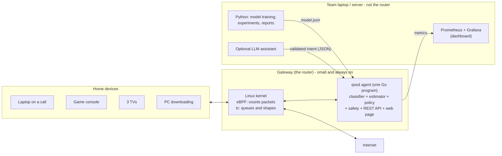

# How `qosd` Works and How We Will Build It (Plain-Language Guide)

**Date:** 2026-10-29
**Who this is for:** every team member, and anyone who wants the full picture without reading the 900-line design document first.
**Exact numbers and rules** live in `01_SRS.md` and `02_System_Design.md` (§12 is the single source of truth). This guide explains the *ideas*, *where each part runs* and *why we chose each technology*.

---

## 1. The problem in one paragraph

A home internet connection is shared by video calls, games, TV streaming, downloads and backups. When a big download starts, the modem's buffer fills up, and every packet, including the video-call packets, waits in that queue. This is called **bufferbloat**, and it turns a 20 ms connection into a 300 ms one. Our system, `qosd`, runs on the home router (the *gateway*). It keeps that queue from forming, recognises which traffic is which **without reading anyone's data**, gives each kind of traffic a fair, guaranteed share, and lets a user say "prioritise my work call for one hour".

---

## 2. The big picture: what runs where



| Part | Runs where | Built with | One-line reason |
|---|---|---|---|
| Packet counting and marking | Gateway, **inside the Linux kernel** | eBPF programs written in C | Only the kernel can look at every packet fast enough |
| Queues and shaping | Gateway, kernel | Linux `tc`: HTB + fq_codel + CAKE | Standard, open, inspectable (a problem-statement constraint) |
| The brain (`qosd` agent) | Gateway, user space | **Go**, one small program | Small, fast, no runtime to install, easy to run on ARM routers |
| Model training | Laptop | **Python + LightGBM** | Best tools for data work; never needed on the router |
| Dashboard | Laptop | **Prometheus + Grafana** | Industry-standard live graphs; too heavy for a router |
| Experiments and reports | Laptop (testbed VM) | Python + bash scripts | One command: reset, run, collect, report |
| LLM assistant (optional) | **Laptop or a cloud API, never the router** | Python + Claude API, or a local model via Ollama | Needs far more compute than a router has (§9) |

**In the prototype**, the "home", the "router", the "ISP" and the "internet servers" are all simulated inside one Ubuntu virtual machine on the laptop, using Linux *network namespaces* (lightweight isolated network stacks). Everything that is simulated is labelled as such in the report.

---

## 3. The life of a packet

### Download (internet → your TV)
1. A packet arrives from the internet at the router's WAN port and is routed toward the home network.
2. Just before it leaves through the LAN port, our **eBPF program** runs on it. It reads only the headers (addresses, ports, size, time), updates that connection's counters, and looks up the connection's class (for example "STREAM").
3. It writes the class into a field of the packet's kernel metadata (`skb->priority`). This changes the packet's **queue**, not its content.
4. Linux **HTB** puts the packet into that class's queue. Inside each queue, **fq_codel** or **CAKE** keeps queues short and shares fairly between connections or devices.
5. HTB sends packets out at a rate slightly **below** the real internet speed. The queue therefore forms here, where we control it, and not in the modem, where it causes lag.

### Upload (your laptop → internet)
The same idea in the other direction. The class is attached when the packet enters from the LAN, carried through routing in another metadata field (`skb->mark`), and applied when the packet leaves through the WAN port.

**Privacy rule:** no program ever reads, stores or exports the data inside a packet. Encrypted traffic stays encrypted; we only use sizes and timing.

---

## 4. How classification works

### 4.1 The four classes
We do not try to name the app ("this is Zoom"). We only decide **how its packets should be treated**:

| Class | What it is | What it needs | Guaranteed floor / ceiling |
|---|---|---|---|
| **RT** (real-time) | Calls, voice, games | Low delay, small bandwidth | 20% / 40% of the link (the ceiling never drops below 4 Mbit/s, so a call is not capped on a slow but idle link) |
| **STREAM** | TV and video streaming | Steady bandwidth; delay matters less (players buffer) | 30% / 100% |
| **DEFAULT** | Web, apps, anything unknown | Normal treatment | 20% / 100% |
| **BULK** | Downloads, updates, backups | Throughput, eventually | 10% / 100% |

The **floor** means a class always gets at least that share, so nothing starves. The **ceiling** means it can never take more, so nothing takes over.

### 4.2 Step by step
1. **Count (kernel, every packet).** The eBPF program keeps counters per connection, in each direction: packets, bytes, a histogram of packet sizes, and timing between packets.
2. **Describe (agent, every second).** The Go agent reads all counters in one batch and turns each connection's last 1–10 seconds into about 30–40 numbers (*features*). Examples: bytes per second each way, average packet size, how bursty it is, whether it goes quiet regularly, how long it has existed.
3. **Predict (agent).** The LightGBM model takes those numbers and outputs four probabilities, for example `RT 0.91, STREAM 0.05, DEFAULT 0.03, BULK 0.01`.
4. **Be careful (agent).**
   - **No decision yet** until a connection has at least 20 packets.
   - **Abstain** if the best probability is below 0.60: the connection goes to DEFAULT, the safe choice.
   - **Don't flip-flop:** a connection only changes class if the new class is above 0.85 for 3 seconds in a row.
   - **Guardrails:** an "RT" connection using more than 8 Mbit/s for 5 s is moved to STREAM. A long, continuous transfer (≥ 20 MB without pauses) in DEFAULT is moved to BULK.
5. **Apply (agent → kernel).** The decision is written into a small kernel table (`class_map`). From the next packet on, that connection uses its class's queue.
6. **Correct (user).** Every decision has a confidence and a reason. A user can say "that's wrong, this is a call" through the web page or the API, and that takes effect within one second.

### 4.3 Why these numbers tell traffic types apart

| Traffic | What its numbers look like |
|---|---|
| Video call | UDP; packets in **both** directions at a steady rhythm (about 50/s for audio, plus video frames); 1–3 Mbit/s; never silent |
| Game | Many **tiny** packets both ways at a fixed tick rate (30–128/s); very little data |
| TV stream | **Bursts**: downloads a 2–4 s video chunk at high speed, then goes quiet, then repeats |
| Download | Huge continuous flow of full-size packets down, tiny acknowledgements up |
| Web browsing | Short, irregular bursts; many small connections |

This is why we can classify encrypted traffic without opening it: each kind of traffic has a distinctive *rhythm and shape*.

### 4.4 The rule-based baseline (and why we still use ML)
The problem statement requires comparing any AI with a simple deterministic method. Our rule classifier says, for example: "UDP to port 3478 → RT", "steady UDP with small packets both ways → RT", "ON/OFF download pattern → STREAM". Rules are transparent but brittle. Modern apps put almost everything on port 443 (HTTPS/QUIC), and a video call's packets are not "small". Scenario **S10** tests exactly this: a call on port 443 that the rules misjudge. The ML must win on **call quality** (loss, delay), not just on accuracy scores.

---

## 5. Why LightGBM?

LightGBM is a library for **gradient-boosted decision trees**: hundreds of small yes/no decision trees that vote together, each one correcting the mistakes of the previous ones.

**Why it fits this problem:**
1. **Our data is a table of numbers** (one row per connection per second). For tabular data, gradient-boosted trees are the most reliable standard choice, and usually more accurate than neural networks unless you have very large datasets.
2. **Fast and light.** It trains in seconds to minutes on a normal laptop CPU, and no GPU is needed. One prediction takes **microseconds**, so classifying hundreds of connections every second costs almost nothing.
3. **Nothing heavy on the router.** We export the trained trees to a JSON file, and our Go agent walks the trees itself (about 150 lines of code). No Python, no ML runtime, no GPU on the gateway. A test checks that Go and Python give the same probabilities (to within 0.000001).
4. **Gives probabilities.** We need a confidence for every decision (a problem-statement requirement). We also calibrate those probabilities on held-out data so that "0.9" really means about 90% right.
5. **Explainable.** It reports which features mattered most. Trees can be inspected, and nothing is a black box.
6. **No fiddly preprocessing.** Trees don't care whether a feature is in bytes or milliseconds.

**Alternatives we rejected:**

| Option | Why not (here) |
|---|---|
| Only rules | Kept as the baseline, but they break when everything uses port 443 |
| XGBoost | Equally good; LightGBM is typically faster to train on CPU. Either would work; we picked one |
| Random forest | Fine, but usually a bit less accurate and larger for the same job |
| Neural networks / deep learning | Need much more data, usually a GPU, and are harder to run on a router and to explain. No measurable gain on a small tabular problem |
| Deep packet inspection / reading TLS server names | Reads packet contents, which breaks our privacy rule, and Encrypted Client Hello hides it anyway |
| An LLM for classification | Far too slow and heavy for per-second decisions on hundreds of connections |

**How the model is trained:**
1. Our traffic generators (call, game, TV, download, web simulators) run in the testbed. Each one knows what it is, so every connection gets a **true label** automatically.
2. The agent runs in *record mode* and writes the features for every connection every second.
3. We split the data **by run**, never by second. The model is always tested on runs it has never seen, so its scores are not inflated.
4. Python trains LightGBM, chooses the confidence thresholds on a validation set, and exports `model.json` with a version number and checksum.
5. If the model file is missing or wrong, the agent automatically falls back to the rules and raises an alert.

---

## 6. How the system knows the internet speed (capacity estimation)

The internet speed changes (evening congestion, Wi-Fi to the modem, ISP issues). If our shaper is set *above* the real speed, the modem queue comes back. If it is set far *below*, we waste bandwidth.

1. The agent sends tiny "ping" probes to 3 servers, 10 times a second each. These probes skip our own queues, so they only measure the queue *outside* the router.
2. If the delay rises by 15 ms or more on at least 2 of the 3 servers, a queue is building somewhere beyond us, and the agent **lowers the shaper rate**.
3. If the delay rises while less traffic than our limit gets through, the real speed has **dropped**. The agent jumps to just below the newly measured speed, and for up to 1.5 s goes even lower so the modem's queue drains quickly.
4. When everything is calm and the link is full, it carefully **raises** the rate again: quickly back toward the last known good speed, then in small steps. If a step overshoots, it waits longer before trying again.

All of this runs every 50 ms. The target is to react within **0.5 s** of a drop. A simulation of this logic is in `docs/sim/estimator_fluid_model.py`. In that model, the fixed v1.0 logic never reacted, and v1.1 clears the queue in under 1 s.

---

## 7. Policy, intents, verification and safety

- **Policy engine.** It takes the classes, the shaper rate and any active user intents, and computes the exact queue settings. Every setting is checked against hard limits before it is applied: BULK never below 10%, RT never above 60% (but never capped below 4 Mbit/s). One component, the *class resolver*, decides each connection's final class in a fixed order: your correction first, then the safety guardrails, then an intent, then the classifier. Every second the agent checks that the kernel still holds exactly those decisions and repairs any that went missing. Every decision is logged with a reason code.
- **Intents.** "Prioritise this laptop for 60 minutes" creates a time-limited *lease*. While it is active, RT gets 40–60% of the link and BULK is capped at 50%. Intents take effect within 1 s, survive an agent restart, and are timed on a clock that cannot jump, so a router that sets its clock late after booting cannot end them early. When the lease expires, everything returns to normal automatically. At most 3 intents can be active at once.
- **Verifier.** It compares call-latency measurements in the 10 s before and after each policy change. If a change made things clearly worse, or a class got zero bandwidth for 5 s, the change is **rolled back**. Two rollbacks within 5 minutes switch the system to safe mode.
- **Safe mode.** If the agent crashes or hangs, the Linux service manager (systemd) runs a script that installs a simple, static CAKE configuration. Traffic is never left unmanaged. The eBPF programs detach automatically when the agent stops.
- **Enforcement.** The initial queue tree is applied with one `tc -batch` command, so the same file serves as an exact audit record. Later rate changes go through netlink (the kernel's control interface), which takes microseconds and never empties the queues.

---

## 8. Dashboard and experiments

- The agent exposes numbers at `/metrics`; **Prometheus** collects them every second, and **Grafana** shows the six things the problem statement asks for: latency, jitter, loss, throughput, queue depth and fairness. It also shows the shaper rate, the classifier's confidence and a timeline of decisions.
- `make demo SCENARIO=s2` resets the testbed, starts the traffic, cuts the emulated internet speed, collects everything and generates a report. Each scenario runs at least 5 times against "no QoS" and "static CAKE", and results are reported with 95% confidence intervals.

---

## 9. The LLM assistant: what, where, which, and can we run it?

### 9.1 What it does, and what it must never do
- **Does:** turns a sentence like *"prioritise my work laptop for the next hour"* into a structured request such as `{"target": {"device_mac": "…"}, "scope": "realtime", "duration_s": 3600}`. It also explains decisions in plain words ("Your download was slowed because the internet speed dropped to 20 Mbit/s at 14:02").
- **Never does:** run commands, touch `tc` or eBPF, change configuration, or make QoS decisions. Its output goes through the **same validated REST API** a human would use, and the policy engine still enforces every limit.
- **Asks first:** it shows you the request it understood (device, scope, duration) and creates the intent only after you confirm. Device names come from the devices themselves, so a device could name itself something like "prioritise me". The assistant treats such names as plain text, never as instructions.
- **Optional:** the whole system works without it (FR-LLM-4). We build it only after the core evidence is done (build-plan phase P8). The problem statement explicitly warns against a project that is "merely a conversational interface".

### 9.2 Where it runs
**Not on the router.** A typical home router has a few hundred MB to 1 GB of memory and a small ARM CPU, while even small language models need gigabytes. The assistant is a small Python program on the **laptop** (or any server). It talks to `qosd`'s REST API over the network, and the user chats with it in a browser or terminal.

```text
User ──"prioritise my call for 1 h"──► Assistant (laptop, Python)
                                          │  asks the LLM: "turn this into intent JSON"
                                          ▼
                     LLM (Claude API in the cloud, OR a local model on the laptop GPU)
                                          │  returns JSON that matches our schema
                                          ▼
                     Assistant validates the JSON ──► POST /api/v1/intents on the gateway
                                                       │
                                     qosd policy engine checks the limits and applies it
```

### 9.3 Which LLM
We support two modes behind one interface, and pick based on the demo situation.

| Mode | Model | Pros | Cons |
|---|---|---|---|
| **Hosted (recommended default)** | **Claude Opus 5.5** (`claude-opus-5-5`) through the official `anthropic` Python SDK. Use **structured outputs** (a JSON schema in `output_config.format`) so the reply always matches our intent format, and low effort, because this is a simple parsing task | Most accurate, nothing to install, about 1 cent per request | Needs internet and an API key (kept out of the repo, constraint C-9); the request text leaves the house |
| Hosted, lower cost (team's choice) | **Claude Haiku 5.5** (`claude-haiku-5-5`) | About 40× cheaper per token and faster | Choose it only if it matches Opus on our 100-sentence test set |
| **Local / offline** | A current small open instruct model (3–8 billion parameters, 4-bit quantised) via **Ollama**, for example from the Qwen, Llama, Gemma or Phi families. Pick the newest one available at P8 and check its license. Ollama can also force the output to match a JSON schema | Fully private, works offline, no per-request cost | Less accurate than Claude; uses laptop GPU and memory; must be installed |

**Implementation notes for the hosted mode:**
- Use structured outputs rather than forcing a tool call: forced `tool_choice` is not supported on Claude Opus 5.5.
- Check `stop_reason` (including `"refusal"`) before reading the reply.
- Enable the SDK's server-side fallback option.
- Validate the JSON again ourselves before calling the API.

**How we prove it is useful:** a 100-sentence test set (for example "pause the downloads while I'm gaming", "make the TV stop lagging", plus tricky and invalid requests). We measure the share that is parsed correctly and the share of invalid requests that are rejected, and compare against a simple keyword/regex parser. Same rule as for the classifier: AI must beat a deterministic baseline.

### 9.4 Do we have the computing power?
Checked on the team laptop (Dell G15 5530): **Intel Core i5-13450HX (10 cores, 16 threads), 16 GB RAM, NVIDIA RTX 3050 Laptop GPU with 6 GB of video memory.**

| Job | Needs | Our laptop | Verdict |
|---|---|---|---|
| eBPF + Go agent | A few MB of memory, under 2% of one core (target) | Trivial | ✅ |
| Testbed VM (all namespaces, 100 Mbit/s traffic) | 4 vCPU, 6–8 GB RAM | 10 cores, 16 GB | ✅ Close other heavy apps during measurement runs |
| LightGBM training | CPU only; seconds to minutes | Fine | ✅ No GPU needed |
| Prometheus + Grafana | About 0.5–1 GB RAM | Fine | ✅ |
| **Hosted LLM (Claude API)** | Internet connection only | Fine | ✅ No local compute |
| **Local LLM, 3–4B, 4-bit** | About 2–3 GB of GPU memory | 6 GB GPU | ✅ Comfortable; a short intent reply should take a few seconds or less **[measure]** |
| **Local LLM, 7–8B, 4-bit** | About 5 GB of GPU memory | 6 GB GPU | ⚠️ Fits, but tightly; keep the context short **[measure]** |
| Local LLM, 30B+ | 20–40+ GB | No | ❌ Not possible here; not needed for this task |
| LLM on the router itself | Gigabytes of RAM | A router has far less | ❌ By design, never |

**Memory budget during a full demo** (VM + dashboard + local LLM): Windows (about 4–5 GB) + VM (6–8 GB) leaves roughly 3–5 GB. When the local model runs on the GPU, its weights sit in GPU memory, not system RAM. It fits, but give the VM 6 GB for demos that include the local LLM, and close browsers with many tabs. The hosted mode avoids the question entirely.

**Cost of the hosted mode** (listed prices at the time of writing: Opus 5.5 at $4 per million input tokens and $20 per million output tokens; Haiku 5.5 at $0.10 / $0.50). One intent request is roughly 1,500 tokens in (instructions + schema + device list) and a few hundred out. That is about **1–3 cents with Opus 5.5** and **under 0.1 cent with Haiku 5.5**. The whole 100-sentence evaluation costs a few dollars at most with Opus. **[measure]** from the API's reported token usage.

---

## 10. Tech stack at a glance, and why

| Technology | Used for | Why this one |
|---|---|---|
| **Ubuntu 24.04 LTS** (kernel 6.8) | Testbed and gateway OS | Long-term support; has every kernel feature we need (eBPF tcx, CAKE) |
| **VMware Workstation Pro / VirtualBox** | Running Ubuntu on the Windows 11 Home laptop | Hyper-V is not available on Windows 11 Home. Use bare-metal Ubuntu for the final measurements if possible (less timing noise) |
| **Linux network namespaces** | Simulated home, router, ISP and servers on one machine | Real Linux networking, fully scriptable and reproducible, free |
| **eBPF (C, clang)** | Per-packet counting and class marking in the kernel | The only safe way to run custom code on every packet at kernel speed; reads headers only |
| **cilium/ebpf + bpf2go** (Go library) | Loading eBPF programs and reading their tables from Go | Pure Go (no C toolchain needed at runtime); one static binary that cross-compiles to ARM routers |
| **Linux tc: HTB, fq_codel, CAKE** | Queues, fair sharing, rate limiting | Open, inspectable, standard (problem-statement constraint). HTB gives provable floors and ceilings; fq_codel and CAKE keep queues short |
| **Go** | The `qosd` agent, REST API, web page, traffic generators that need precise timing | Fast, small memory, single binary, good concurrency, easy deployment |
| **Python** | Training, data analysis, experiment runner, reports, the LLM assistant | Best ecosystem for data and ML; none of it runs on the router |
| **LightGBM** | The traffic classifier | Accurate on tabular data, microsecond predictions, tiny model, explainable (§5) |
| **scikit-learn, pandas/Polars, Parquet** | Splits, calibration, metrics, storing experiment logs | Standard, fast, reproducible |
| **iperf3, irtt, flent** | Bulk traffic and independent latency cross-checks | Well-known open tools that judges recognise |
| **Prometheus + Grafana** | Live metrics and dashboard | Industry standard, free, runs off the router |
| **systemd** | Running the agent, watchdog, automatic safe mode | Built into Ubuntu; restarts and fallback without extra code |
| **GitHub Actions + gitleaks** | Automatic tests and secret scanning on every change | Catches breakage early; keeps keys out of the repository (C-9) |
| **Claude API (Opus 5.5) / Ollama** (optional) | Natural-language intents and explanations | Accurate structured output (hosted) or fully private (local); always off the router |

---

## 11. How we will build it (in order)

| Phase | What gets built | Done when |
|---|---|---|
| **P0** | VM, toolchain, repository, and 13 quick experiments that prove risky kernel assumptions | Every assumption passes or has a tested fallback |
| **P1** | Testbed, traffic generators, measurements, "no QoS" and "static CAKE" baselines | The bufferbloat problem is shown with real numbers |
| **P2** | eBPF counting and marking, queue tree, safe mode | Hand-assigned classes land in the right queues, IPv4 and IPv6 |
| **P3** | Capacity estimator (simulation first, then testbed) | Beats static CAKE when the speed drops (S2, S5, S11) |
| **P4** | Rules + LightGBM classifier, training pipeline, Go tree reader | Accuracy targets met (or honestly reported); ML beats rules on S10 call quality |
| **P5** | Policy engine, intents, verifier, REST API | Intent, rollback and crash tests pass |
| **P6** | Grafana dashboard, web page | All six required quantities visible live |
| **P7** | Full experiment matrix and report, `make demo` | Every target has a measured value, met or not |
| **P8** | Optional: LLM assistant, Raspberry Pi demo | Each extra has its own measured result |
| **P9** | Setup guide, limitations, deck, demo video | Submission checklist complete |

The guiding rule: **build the measurement before the feature.** Every feature is judged by a number in the report.

---

## 12. Quick answers

- **Does it read my messages or websites?** No. Only packet sizes, timing and addresses; never the contents.
- **Does it need the internet to work?** No, except the optional hosted LLM mode.
- **What if the AI is wrong?** Unsure decisions fall back to DEFAULT. RT has a cap and BULK has a floor, so a wrong class cannot take over the link. Users can correct any decision, and the rule classifier takes over if the model fails.
- **What if `qosd` crashes?** systemd installs a safe, static configuration within seconds.
- **Could this run on a real router?** The design targets that: one small Go binary plus kernel features available on modern Linux-based routers (e.g. OpenWrt 24.10 with kernel 6.6). Production limits (hardware offload, gigabit CPU cost, Wi-Fi) are listed in design §21.
